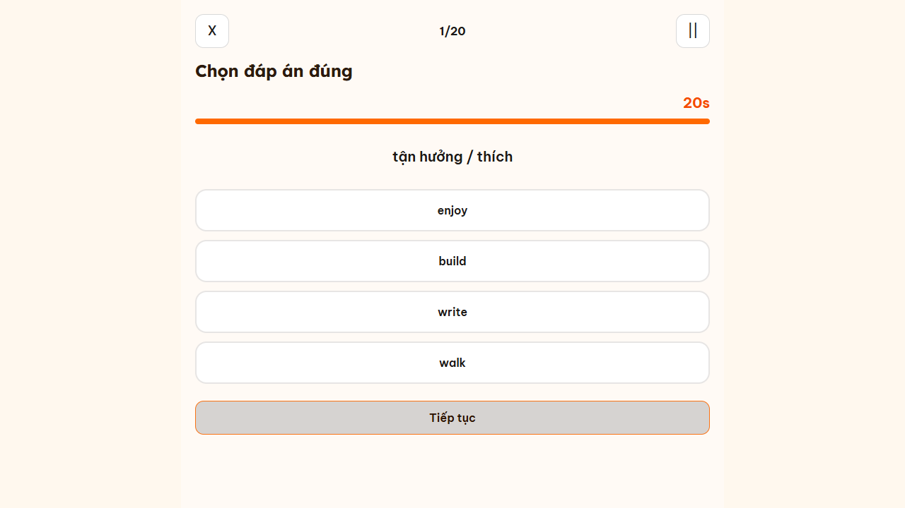
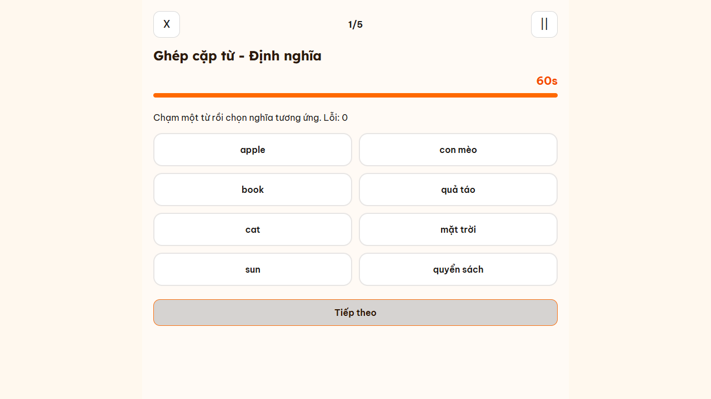
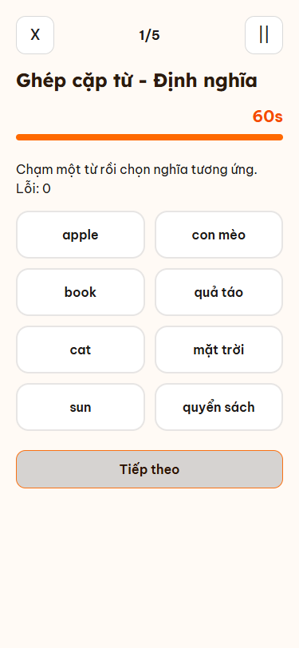

# Hai dạng bài thi từ vựng — 14/11/2026

## Bước 0: khảo sát trước khi sửa

Đã báo kết quả khảo sát trong hội thoại trước khi bắt đầu sửa mã.

| Phần | Vị trí và trách nhiệm |
|---|---|
| Enum BE | `Quiz/domain/QuizType.java`, `QuizQuestion/domain/QuestionType.java` |
| Định nghĩa/sinh bài cũ | `Quiz/QuizServiceImpl.java`, `QuizQuestion/QuizQuestionServiceImpl.java`, `ai/service/AiQuizGeneratorService.java`; nội dung seed trong migration V23, V34, V38–V43, V52 |
| Bắt đầu và snapshot | `QuizAttempt/QuizAttemptServiceImpl.startAttempt`, `QuizAttemptQuestion`, `QuizAttemptOption` |
| Nộp/chấm/XP/kết quả | `QuizAttemptServiceImpl.submit`, `buildDetailResponse`; `QuizAnswer`, `QuizAttempt` lưu kết quả và `xp_awarded` |
| Lịch sử/hoạt động | `/quiz-attempts/my`, `findMyAttempts`, `DailyLearningActivityServiceImpl.aggregateHistory` |
| Web | `features/quiz/pages/{QuizzesPage,QuizAttemptPage,QuizAttemptResultPage,MyQuizAttemptsPage}.tsx`, `ExamQuestionCard`, `ExamReviewCard`, các API trong `features/quiz/api` |
| Mobile | `features/quiz/screens/{QuizListScreen,QuizExamScreen,QuizResultScreen}.tsx`; `features/quiz/services/quizService.ts`; lịch sử/ôn bài trong `features/study/screens/AssessmentHistoryScreen`, `AssessmentReviewDetailScreen` |

Đồ thị mã lúc khảo sát cũ hơn HEAD; đã đối chiếu trực tiếp mã nguồn thay vì coi kết quả đồ thị là đầy đủ.

### Kho từ chung thực tế

Truy vấn chỉ đọc MySQL local, ngày 14/11/2026: **173 bộ thẻ PUBLIC/PUBLISHED của tài khoản hệ thống `admin`; 3.151 thẻ đang hoạt động, 2.909 từ phân biệt** theo lower/trim. Không dùng bộ thẻ cá nhân hoặc `card_progress` để sinh bài.

| Cấp độ `decks.level_id` | Số thẻ |
|---|---:|
| 1 | 427 |
| 2 | 639 |
| 3 | 1.100 |
| 4 | 820 |
| Không có cấp độ | 165 |

- Từ Anh: `flashcards.front_text`; nghĩa Việt: `back_text`; loại từ: `part_of_speech`; cấp độ ở `decks.level_id`. Có phonetic/audio và `related_words`.
- Không có nghĩa rỗng hay loại từ rỗng trong tập khảo sát. 2.197 thẻ có `related_words`, nhưng trường này chứa cả biến thể từ, không phải một từ điển đồng nghĩa đã biên tập.
- Chất lượng không đồng đều: `Abide by → tuân theo, tôn trọng contract`; từ còn dính `(a.)`, hoặc `Fulfilling gerund fulfillment n`; có từ loại chưa chính xác. Các trường hợp bất hợp lệ được bỏ qua, không sửa hoặc bịa nghĩa thay thế.
- Bộ sinh bỏ thẻ thiếu cấp độ, từ lỗi định dạng, nghĩa rỗng/placeholder/lẫn mục từ Anh đã biết; loại nghĩa trùng, giao nhau hoặc chứa nhau và quan hệ trong `related_words`. Ưu tiên nhiễu cùng loại từ, bắt buộc cùng cấp độ. Toàn bộ từ/đáp án được lấy từ DB.
- Kho có đủ dữ liệu dùng cho hai dạng nên tiếp tục triển khai. Chưa có thẩm định ngôn ngữ thủ công cho toàn bộ kho; không suy ra mọi lỗi đồng nghĩa/đa nghĩa trong nguồn đã được giải quyết chỉ từ test tự động.

### Điểm mở rộng nhỏ nhất

Thêm hai enum, mở rộng CHECK bằng V54, dùng snapshot/attempt/answer đang có. Cần bổ sung ledger trạng thái câu/màn để server kiểm tra thời gian và từng lần ghép; không thể kiểm chứng điều này chỉ bằng payload nộp cuối của API cũ. Phần mới dùng một bảng `timed_quiz_states`, không refactor module quiz cũ.

## Hành vi bổ sung

- `MULTIPLE_CHOICE_MEANING`: mặc định 20 câu, 20 giây/câu, tối đa bốn lựa chọn, đúng một đáp án; thiếu nguồn thì giảm lựa chọn hoặc số câu.
- `MATCHING_PAIRS`: mặc định năm màn, bốn cặp/màn, 60 giây/màn; hai cột xáo độc lập, ID hai phía độc lập, khóa cặp đúng; server ghi lỗi sai. Các màn dùng từ khác nhau.
- Server ghi deadline, xử lý timeout và dung sai hai giây. `||` tạm dừng server và che nội dung; chuyển nền chỉ dừng hiển thị client, quay lại đồng bộ hạn server.
- X/Thoát xác nhận rồi nộp vào luồng `/quiz-attempts/{id}/submit` cũ. Giữ đáp án/cặp đã xác nhận, không thưởng phần chưa làm, ghi `abandoned_at`; không sửa hoặc giảm streak. Bắt đầu lần sau tạo attempt mới.
- Điểm ghép: `max(0, đúng × pairPoints − lỗi × errorPenalty)`, mặc định `1` và `0.25`; snapshot cấu hình khi bắt đầu. Hai trường cộng thêm `preciseScore`, `preciseMaxScore` giữ điểm thập phân; trường integer cũ vẫn tồn tại.
- Giữ cơ chế XP của submit hiện có: lưu `xp_awarded` vào attempt, dùng 10 XP cho mỗi đáp án/cặp đúng đã được server xác nhận. Không tạo ledger XP hoặc cập nhật `users.xp_total` riêng cho hai dạng mới. Không khẳng định đã sửa cách đồng bộ tổng XP của luồng quiz cũ.
- Event có `requestId`; gửi lại cùng payload không ghi thêm lỗi hoặc điểm. Nộp cuối khóa trạng thái và trả kết quả đã có nếu đã nộp. Câu trả lời client không thể ghi đè ledger server.
- Bài trộn dùng renderer cũ cho câu cũ rồi các màn mới; nộp một lần với câu trả lời cũ và ledger mới. Bài chỉ có dạng cũ vẫn giữ thứ tự, UI và cách chấm cũ.
- Hai template mới được đánh dấu inactive/deleted để không chen vào catalog của client cũ. Client mới dùng capability endpoint riêng; các giá trị enum cũ và thứ tự của chúng được giữ nguyên.

## API và cấu hình

API cộng thêm, cùng backend web/mobile:

```
GET  /quiz-attempts/vocabulary/modes
POST /quiz-attempts/vocabulary/start/{MULTIPLE_CHOICE_MEANING|MATCHING_PAIRS}
POST /quiz-attempts/vocabulary/{attemptId}/event
```

Event gồm `action`, `index`, `requestId`, tùy chọn `leftId/rightId`; action: BEGIN, ANSWER, PAIR, TIMEOUT, PAUSE, RESUME, NEXT, SYNC. Chỉ chủ attempt được thao tác. API submit cũ được giữ; trường `abandoned` là tùy chọn bổ sung. Detail có thêm `timedScreen`, và `timedReview` chỉ có nội dung sau nộp.

Cấu hình trong `application.yaml`, prefix `app.quiz.vocabulary`, có biến môi trường:

```
QUIZ_MEANING_ENABLED=true       QUIZ_MATCHING_ENABLED=true
QUIZ_MEANING_SECONDS=20         QUIZ_MATCHING_SECONDS=60
QUIZ_MEANING_COUNT=20           QUIZ_MATCHING_COUNT=5
QUIZ_TIME_TOLERANCE_SECONDS=2
QUIZ_PAIR_POINTS=1              QUIZ_PAIR_ERROR_PENALTY=0.25
QUIZ_SYSTEM_OWNER=admin
```

## Kiểm chứng

- BE: `mvnw.cmd test`: **430 test, 397 pass, 33 skip, 0 fail/error**; trong đó 15 test mới (8 unit, 7 tích hợp MySQL). Bao gồm kho ít, lọc dữ liệu lỗi, ưu tiên loại từ, lựa chọn/cặp không trùng, công thức, hạn giờ/dung sai, pause, tài khoản chưa có `card_progress`, timeout ghép giữ phần đúng, bài trộn, submit trùng và lịch sử.
- Web: **9/9 pass**, gồm sáu kiểm tra hai dạng mới/đồng hồ/thoát/layout và ba hồi quy renderer cũ. `npx tsc --noEmit` và `npm run build` pass.
- Mobile: **11/11 pass** bằng `react-test-renderer`: tám kiểm tra mới và ba hồi quy màn cũ. Dùng component/hook thật, thay host native, mạng và TTS bằng adapter; không phải test thiết bị thật. `npx tsc --noEmit` pass.
- Android: `npx expo export --platform android --output-dir dist-quiz` pass. Đây là bundle Hermes, không phải APK đã ký. Máy chưa có `adb` hoặc EAS CLI sẵn để kiểm chứng native build.
- Mã mới mobile qua ESLint. Lint toàn mobile có lỗi có sẵn; đã so `HEAD` với bản sửa của ba màn quiz, số lỗi không tăng (2/1/1). Chi tiết giới hạn bên dưới.
- Ảnh dưới là component web thật chạy với fixture test, không phải ảnh đo phiên BE thật hay ảnh native mobile. Đã xem ảnh desktop và 375px để kiểm tra bố cục, nội dung và vùng chạm.







## Giới hạn và lưu ý vận hành

- Chưa thử thiết bị Android/iOS thật, khóa màn hình thật, giọng đọc vật lý hoặc build APK/iOS ký số. Các sự kiện AppState có test adapter, chưa xác minh cách hệ điều hành giao sự kiện trên từng máy.
- Lint toàn mobile chưa sạch: **62 lỗi/72 cảnh báo**, bằng baseline sau khi đối chiếu các file đã sửa với nội dung HEAD. Các lỗi tại ba màn quiz cũng có trong HEAD. Không mở rộng sửa các module auth/study/navigation. Đã bỏ các cảnh báo kiểu mảng do phần bổ sung tạo ra.
- Expo CLI tự cài công cụ lint nhưng `expo lint` vẫn báo không nhận phiên bản ESLint; chạy ESLint trực tiếp để kiểm chứng. Có cấu hình/script lint để tái hiện.
- Không triển khai lại BE đang chạy. Migration được chạy và kiểm tra bởi context integration test trên DB local; server đang chạy cần được khởi động lại từ bản build mới để phục vụ endpoint mới.
- V54 lần thử đầu thiếu `created_by`; đã bổ sung và chỉ gỡ marker V54 thất bại để chạy lại DDL bổ sung. Không chỉnh migration cũ hoặc xóa dữ liệu quiz trước đó.
- Không commit `.env`, credential, build output, log kiểm thử hoặc các thay đổi voice đang có trong workspace.

## File thay đổi

- BE: `Quiz/domain/QuizType.java`; `QuizQuestion/domain/QuestionType.java`; `Quiz/timed/{TimedQuizProperties,VocabularyRepository,VocabularyGenerator,TimedQuizState,TimedQuizStateRepository,TimedQuizEngine,TimedQuizController}.java`.
- BE tích hợp: `QuizAttempt/QuizAttemptServiceImpl.java`, `QuizAttempt/domain/QuizAttempt.java`, `QuizAttempt/dto/{QuizAttemptDetailResponse,QuizAttemptReponse,QuizSubmitRequest}.java`, `application.yaml`, migration `V54__add_timed_vocabulary_quizzes.sql`.
- BE test: `Quiz/timed/{VocabularyGeneratorTest,TimedVocabularyIntegrationTest}.java`.
- Web: `features/quiz/api/timed-vocabulary.api.ts`; `components/{useTimedVocabularyQuiz,TimedVocabularyQuiz,TimedVocabularyResult}`; `pages/{QuizzesPage,QuizAttemptPage,QuizAttemptResultPage}.tsx`; `playwright.vocabulary.config.ts`, `tests/vocabulary-quiz.{html,tsx}`, `tests/vocabulary/quiz.spec.ts`.
- Mobile: `features/quiz/components/{useTimedVocabularyQuiz,TimedVocabularyQuiz}`, `services/timedVocabularyService.ts`, `screens/{QuizListScreen,AssessmentCenterScreen,QuizExamScreen,QuizResultScreen}.tsx`, `types/index.ts`, `tests/timed-vocabulary.test.cjs`, `package.json`, `package-lock.json`, `eslint.config.js`, `.gitignore`.
- Tài liệu: `.project_memory.md`, tài liệu này và ba PNG trong `docs/quiz-vocabulary`.
