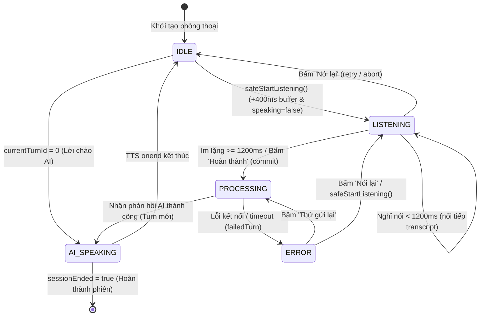

## 3. Danh Sách Giao Diện Lập Trình Ứng Dụng (API Reference)
Toàn bộ các endpoint của phân hệ Voice Conversation được bảo vệ bởi Spring Security (`Bearer JWT Token`). Khi `server.servlet.context-path` được cấu hình là `/api/v1` trong `application.yaml`, các endpoint được tiền tố hóa bằng `/api/v1`.

### 3.1. Bảng Tổng Hợp Endpoint Dành Cho Học Viên
| Phương thức | Đường dẫn URL | Request DTO | Response DTO | Mã HTTP & Lỗi | Quyền (Auth) |
| :---: | :--- | :--- | :--- | :--- | :--- |
| `GET` | `/api/v1/voice-conversations/status` | Không | `VoiceStatusResponse` | 200, 401, 403 | Authenticated Learner |
| `GET` | `/api/v1/voice-conversations/scenarios` | Không | `List<ConversationScenarioDto>` | 200, 401, 403 | Authenticated Learner |
| `POST` | `/api/v1/voice-conversations/sessions/start` | `VoiceStartRequest` (optional) | `VoiceStartResponse` | 200, 400, 401, 403, 500 | Authenticated Learner |
| `POST` | `/api/v1/voice-conversations/sessions/{publicId}/turns` | `VoiceTurnRequest` | `VoiceTurnResponse` | 200, 400, 401, 404, 500 | Owner of Session |
| `POST` | `/api/v1/voice-conversations/sessions/{publicId}/finish` | `VoiceFinishRequest` (optional) | `VoiceReportResponse` | 200, 401, 404, 500 | Owner of Session |
| `POST` | `/api/v1/voice-conversations/sessions/{publicId}/feedback` | `VoiceFeedbackRequest` | `VoiceReportResponse` | 200, 400, 401, 404, 409 | Owner of Session |
| `POST` | `/api/v1/voice-conversations/sessions/{publicId}/abandon` | Không | `Void` (204 No Content) | 204, 401, 404 | Owner of Session |

### 3.2. Bảng Tổng Hợp Endpoint Quản Trị & Giám Sát (Admin AI)
| Phương thức | Đường dẫn URL | Request DTO | Response DTO | Mã HTTP | Quyền (Auth) |
| :---: | :--- | :--- | :--- | :--- | :--- |
| `GET` | `/api/v1/admin/ai/scenarios` | Query params (topicId, isActive, search...) | `ApiResponse<Page<AdminScenarioResponse>>` | 200, 401, 403 | `ROLE_ADMIN` |
| `GET` | `/api/v1/admin/ai/scenarios/{id}` | Path variable | `ApiResponse<AdminScenarioResponse>` | 200, 401, 403, 404 | `ROLE_ADMIN` |
| `POST` | `/api/v1/admin/ai/scenarios` | `AdminScenarioRequest` | `ApiResponse<AdminScenarioResponse>` | 201, 400, 401, 403 | `ROLE_ADMIN` |
| `PUT` | `/api/v1/admin/ai/scenarios/{id}` | `AdminScenarioRequest` | `ApiResponse<AdminScenarioResponse>` | 200, 400, 401, 403, 404 | `ROLE_ADMIN` |
| `DELETE` | `/api/v1/admin/ai/scenarios/{id}` | Path variable | `ApiResponse<Void>` | 200, 401, 403, 404 | `ROLE_ADMIN` |
| `POST` | `/api/v1/admin/ai/scenarios/{id}/clone` | Path variable | `ApiResponse<AdminScenarioResponse>` | 201, 401, 403, 404 | `ROLE_ADMIN` |
| `PATCH` | `/api/v1/admin/ai/scenarios/{id}/toggle-status` | Path variable | `ApiResponse<AdminScenarioResponse>` | 200, 401, 403, 404 | `ROLE_ADMIN` |
| `GET` | `/api/v1/admin/ai/monitoring/overview` | Không | `ApiResponse<AdminAiOverviewStats>` | 200, 401, 403 | `ROLE_ADMIN` |
| `GET` | `/api/v1/admin/ai/monitoring/sessions` | Query params (status, userId, date...) | `ApiResponse<Page<AdminVoiceSessionResponse>>` | 200, 401, 403 | `ROLE_ADMIN` |
| `GET` | `/api/v1/admin/ai/monitoring/sessions/{id}` | Path variable | `ApiResponse<AdminVoiceSessionDetailResponse>` | 200, 401, 403, 404 | `ROLE_ADMIN` |
| `GET` | `/api/v1/admin/ai/monitoring/quota-ledger` | Query params (userId, entryType...) | `ApiResponse<Page<AdminQuotaLedgerResponse>>` | 200, 401, 403 | `ROLE_ADMIN` |
| `POST` | `/api/v1/admin/ai/monitoring/quota-ledger/adjust`| `AdminAdjustQuotaRequest` | `ApiResponse<AdminQuotaLedgerResponse>` | 201, 400, 401, 403 | `ROLE_ADMIN` |

### 3.3. Chi Tiết Payload & Ví Dụ JSON Cho Từng Endpoint Học Viên

#### 1. GET `/api/v1/voice-conversations/status`
- **Mục đích**: Lấy thông tin cấp độ hiện tại, trạng thái mở khóa, số lượt còn lại và kiểm tra có phiên thoại nào đang dở dang (`inProgressPublicId`).
- **Dẫn chứng mã nguồn**: [VoiceConversationController.java:36-40](file:///f:/ProJectLeLa/LeLa_BE/src/main/java/com/lela/voice/controller/VoiceConversationController.java#L36-L40), [VoiceConversationServiceImpl.java:132-170](file:///f:/ProJectLeLa/LeLa_BE/src/main/java/com/lela/voice/service/VoiceConversationServiceImpl.java#L132-L170).
- **Ví dụ Response (200 OK)**:
```json
{
  "unlocked": true,
  "learnedCardsCount": 45,
  "requiredCardsCount": 20,
  "remainingQuota": -1,
  "maxSessionsPerDay": -1,
  "maxDailyTurns": -1,
  "usedTurns": 2,
  "remainingTurns": -1,
  "canStart": true,
  "nextResetAt": "2026-11-14T00:00:00+07:00",
  "currentLevel": 200,
  "initialBandMin": 100,
  "highestLevel": 250,
  "totalSessions": 5,
  "consecutiveHardCount": 0,
  "hasInProgressSession": false,
  "inProgressPublicId": null,
  "uiConfig": {
    "ttsRate": 0.83,
    "bilingualSupport": true,
    "autoHintOnSilence": true,
    "silenceThresholdSeconds": 8
  }
}
```

#### 2. GET `/api/v1/voice-conversations/scenarios`
- **Mục đích**: Lấy danh sách các tình huống giao tiếp phù hợp với level hiện tại của người học.
- **Dẫn chứng mã nguồn**: [VoiceConversationController.java:42-46](file:///f:/ProJectLeLa/LeLa_BE/src/main/java/com/lela/voice/controller/VoiceConversationController.java#L42-L46), [VoiceConversationServiceImpl.java:172-198](file:///f:/ProJectLeLa/LeLa_BE/src/main/java/com/lela/voice/service/VoiceConversationServiceImpl.java#L172-L198).
- **Ví dụ Response (200 OK)**:
```json
[
  {
    "id": 1,
    "title": "Order at a Coffee Shop",
    "slug": "order-coffee-shop",
    "levelMin": 100,
    "levelMax": 500,
    "aiRole": "Barista",
    "userRole": "Customer",
    "description": "Gọi đồ uống và bánh ngọt tại quán cà phê thân thiện.",
    "openingLine": "Hello! Welcome to LeLa Coffee. What would you like to drink today?",
    "isActive": true
  }
]
```

#### 3. POST `/api/v1/voice-conversations/sessions/start`
- **Mục đích**: Bắt đầu một phiên thoại mới. Chọn 3–5 từ mục tiêu (ưu tiên từ yếu), tạo bản ghi phiên `IN_PROGRESS` với khóa bi quan (`PESSIMISTIC_WRITE`), lưu Turn 0 (lời chào AI).
- **Dẫn chứng mã nguồn**: [VoiceConversationController.java:48-52](file:///f:/ProJectLeLa/LeLa_BE/src/main/java/com/lela/voice/controller/VoiceConversationController.java#L48-L52), [VoiceConversationServiceImpl.java:200-277](file:///f:/ProJectLeLa/LeLa_BE/src/main/java/com/lela/voice/service/VoiceConversationServiceImpl.java#L200-L277).
- **Ví dụ Request Payload**:
```json
{
  "scenarioSlug": "order-coffee-shop"
}
```
- **Ví dụ Response (200 OK)**:
```json
{
  "publicId": "7b8f9e01-2345-6789-abcd-ef0123456789",
  "scenarioTitle": "Order at a Coffee Shop",
  "aiRole": "Barista",
  "userRole": "Customer",
  "openingLine": "Hello! Welcome to LeLa Coffee. What would you like to drink today?",
  "currentLevel": 200,
  "durationSecondsLimit": 300,
  "maxTurns": 10,
  "targetWords": [
    {
      "flashcardId": 101,
      "word": "coffee",
      "meaning": "cà phê",
      "phonetic": "/ˈkɒfi/",
      "usedCorrectly": false,
      "status": "UNUSED"
    },
    {
      "flashcardId": 102,
      "word": "order",
      "meaning": "đặt món, gọi món",
      "phonetic": "/ˈɔːrdər/",
      "usedCorrectly": false,
      "status": "UNUSED"
    },
    {
      "flashcardId": 103,
      "word": "delicious",
      "meaning": "thơm ngon",
      "phonetic": "/dɪˈlɪʃəs/",
      "usedCorrectly": false,
      "status": "UNUSED"
    }
  ],
  "uiConfig": {
    "ttsRate": 0.83,
    "bilingualSupport": true,
    "autoHintOnSilence": true,
    "silenceThresholdSeconds": 8
  }
}
```

#### 4. POST `/api/v1/voice-conversations/sessions/{publicId}/turns`
- **Mục đích**: Gửi câu thoại hoàn chỉnh của học viên lên để Gemini phân tích, sửa lỗi, so khớp từ mục tiêu và sinh câu thoại tiếp theo.
- **Dẫn chứng mã nguồn**: [VoiceConversationController.java:54-61](file:///f:/ProJectLeLa/LeLa_BE/src/main/java/com/lela/voice/controller/VoiceConversationController.java#L54-L61), [VoiceConversationServiceImpl.java:279-465](file:///f:/ProJectLeLa/LeLa_BE/src/main/java/com/lela/voice/service/VoiceConversationServiceImpl.java#L279-L465).
- **Ví dụ Request Payload**:
```json
{
  "transcript": "I like horse coffee and a croissant please",
  "sttConfidence": 0.94,
  "clientElapsedSeconds": 45,
  "isRetry": false,
  "alternatives": ["I like hot coffee and a croissant please"],
  "previousAiQuestion": "Hello! Welcome to LeLa Coffee. What would you like to drink today?"
}
```
- **Ví dụ Response (200 OK — Chế độ bình thường)**:
```json
{
  "turnNumber": 1,
  "aiReply": "Sure thing! One hot coffee and a croissant. Would you like that with whole milk or oat milk?",
  "grammarErrors": [],
  "correctedSentence": "I would like a hot coffee and a croissant, please.",
  "quickSuggestion": "I would like oat milk, please.",
  "updatedTargetWords": [
    {
      "flashcardId": 101,
      "word": "coffee",
      "meaning": "cà phê",
      "phonetic": "/ˈkɒfi/",
      "usedCorrectly": true,
      "status": "USED_CORRECT"
    }
  ],
  "validTurnCount": 1,
  "sessionEnded": false,
  "endReason": null,
  "evaluation": {
    "isGood": true,
    "hasError": false,
    "score": 90,
    "status": "EXCELLENT",
    "grammarCheck": "Ngữ pháp chính xác",
    "phoneticTip": "Lưu ý phát âm âm cuối /t/ trong từ hot để không bị nhận nhầm thành horse",
    "suggestedImprovement": "I would like a hot coffee and a croissant, please."
  },
  "degraded": false,
  "errorCode": null,
  "intendedUtterance": "I like hot coffee and a croissant please",
  "isCompleted": false
}
```
- **Ví dụ Response (200 OK — Chế độ Degraded Mode khi toàn bộ Gemini lỗi/hết quota)**:
```json
{
  "turnNumber": 1,
  "aiReply": "Welcome to our coffee shop! What can I get for you today?",
  "grammarErrors": [],
  "correctedSentence": "I like horse coffee and a croissant please",
  "quickSuggestion": "Could you please tell me more?",
  "updatedTargetWords": [],
  "validTurnCount": 1,
  "sessionEnded": false,
  "endReason": null,
  "evaluation": null,
  "degraded": true,
  "errorCode": "GEMINI_HTTP_429",
  "intendedUtterance": "I like horse coffee and a croissant please",
  "isCompleted": false
}
```

#### 5. POST `/api/v1/voice-conversations/sessions/{publicId}/finish`
- **Mục đích**: Chốt phiên hội thoại, tính toán điểm số 3 tiêu chí, cộng XP có kiểm tra trần ngày (150 XP), ghi nhận chuỗi streak và trả về báo cáo tổng kết. Endpoint có tính chất **Idempotent** (gọi lại trả đúng kết quả cũ, không cộng dồn XP 2 lần).
- **Dẫn chứng mã nguồn**: [VoiceConversationController.java:63-70](file:///f:/ProJectLeLa/LeLa_BE/src/main/java/com/lela/voice/controller/VoiceConversationController.java#L63-L70), [VoiceConversationServiceImpl.java:467-478](file:///f:/ProJectLeLa/LeLa_BE/src/main/java/com/lela/voice/service/VoiceConversationServiceImpl.java#L467-L478), [VoiceSessionFinalizer.java:41-164](file:///f:/ProJectLeLa/LeLa_BE/src/main/java/com/lela/voice/service/VoiceSessionFinalizer.java#L41-L164).
- **Ví dụ Request Payload**:
```json
{}
```
- **Ví dụ Response (200 OK)**:
```json
{
  "publicId": "7b8f9e01-2345-6789-abcd-ef0123456789",
  "overallScore": 82,
  "pronunciationScore": null,
  "grammarScore": 85,
  "fluencyScore": 80,
  "vocabularyScore": 81,
  "systemRecommendation": "INCREASE",
  "userFeedback": null,
  "oldLevel": 200,
  "newLevel": 200,
  "xpAwarded": 25,
  "consecutiveHardWarning": false,
  "targetWords": [
    {
      "flashcardId": 101,
      "word": "coffee",
      "meaning": "cà phê",
      "usedCorrectly": true,
      "status": "USED_CORRECT"
    }
  ],
  "corrections": [
    {
      "turnNumber": 1,
      "originalTranscript": "I like horse coffee and a croissant please",
      "errors": [],
      "correctedText": "I would like a hot coffee and a croissant, please."
    }
  ]
}
```

#### 6. POST `/api/v1/voice-conversations/sessions/{publicId}/feedback`
- **Mục đích**: Học viên chọn độ khó trên modal tổng kết (`EASY` | `COMFORTABLE` | `HARD`). Hệ thống áp dụng tăng/giữ/giảm cấp độ (+50 / 0 / -50) đúng 1 lần duy nhất.
- **Ràng buộc**: Phiên chưa `COMPLETED` trả về HTTP `409 CONFLICT`. Đã có feedback trước đó trả về báo cáo cũ mà không đổi level lần 2.
- **Dẫn chứng mã nguồn**: [VoiceConversationController.java:72-79](file:///f:/ProJectLeLa/LeLa_BE/src/main/java/com/lela/voice/controller/VoiceConversationController.java#L72-L79), [VoiceConversationServiceImpl.java:480-514](file:///f:/ProJectLeLa/LeLa_BE/src/main/java/com/lela/voice/service/VoiceConversationServiceImpl.java#L480-L514).
- **Ví dụ Request Payload**:
```json
{
  "feedback": "EASY"
}
```
- **Ví dụ Response (200 OK)**:
```json
{
  "publicId": "7b8f9e01-2345-6789-abcd-ef0123456789",
  "overallScore": 82,
  "pronunciationScore": null,
  "grammarScore": 85,
  "fluencyScore": 80,
  "vocabularyScore": 81,
  "systemRecommendation": "INCREASE",
  "userFeedback": "EASY",
  "oldLevel": 200,
  "newLevel": 250,
  "xpAwarded": 25,
  "consecutiveHardWarning": false,
  "targetWords": [],
  "corrections": []
}
```

#### 7. POST `/api/v1/voice-conversations/sessions/{publicId}/abandon`
- **Mục đích**: Học viên bấm nút Thoát / Hủy phòng gọi giữa chừng. Chuyển trạng thái phiên thành `ABANDONED`.
- **Dẫn chứng mã nguồn**: [VoiceConversationController.java:81-86](file:///f:/ProJectLeLa/LeLa_BE/src/main/java/com/lela/voice/controller/VoiceConversationController.java#L81-L86), [ConversationQuotaService.java:150-166](file:///f:/ProJectLeLa/LeLa_BE/src/main/java/com/lela/voice/service/ConversationQuotaService.java#L150-L166).
- **Response**: HTTP 204 No Content.

---

## 4. Mô Hình Dữ Liệu Cơ Sở Dữ Liệu (Data Model)
Cơ sở dữ liệu của phân hệ Voice Conversation được quản lý bởi Flyway qua các bản di trú `V49`, `V50`, `V53` kết hợp các bảng gốc từ `V1`. Dưới đây là đặc tả chi tiết của từng bảng.

### 4.1. Bảng `user_conversation_levels` (Cấp độ hội thoại người học)
- **Dẫn chứng di trú**: [V49__create_voice_conversation_tables.sql:5-17](file:///f:/ProJectLeLa/LeLa_BE/src/main/resources/db/migration/V49__create_voice_conversation_tables.sql#L5-L17).
- **Dẫn chứng JPA Entity**: [UserConversationLevel.java:1-71](file:///f:/ProJectLeLa/LeLa_BE/src/main/java/com/lela/voice/domain/UserConversationLevel.java#L1-L71).
| Tên cột | Kiểu dữ liệu | Nullable / Default | Ràng buộc / Khóa ngoại | Mục đích nghiệp vụ |
| :--- | :--- | :--- | :--- | :--- |
| `user_id` | `BIGINT` | NOT NULL | `PRIMARY KEY`, `FK -> users(id)` (CASCADE) | Khóa chính trùng với id học viên (quan hệ 1-1). |
| `current_level` | `INT` | NOT NULL DEFAULT 200 | `CHECK (level >= 100 AND level <= 1000 AND (level % 50 = 0))` | Cấp độ hội thoại hiện tại, là bội của 50. |
| `initial_band_min` | `INT` | NOT NULL DEFAULT 100 | Sàn khởi điểm | Sàn tối thiểu cố định theo CEFR Onboarding. |
| `highest_level` | `INT` | NOT NULL DEFAULT 200 | Không | Cấp độ cao nhất học viên từng đạt được. |
| `total_sessions` | `INT` | NOT NULL DEFAULT 0 | Không | Tổng số phiên thoại đã hoàn thành. |
| `consecutive_hard_count` | `INT` | NOT NULL DEFAULT 0 | Không | Đếm số phiên liên tiếp chọn 'Khó quá' (>= 3 hiện cảnh báo). |
| `created_at` | `DATETIME(6)` | DEFAULT CURRENT_TIMESTAMP(6) | Không | Thời điểm tạo bản ghi. |
| `updated_at` | `DATETIME(6)` | ON UPDATE CURRENT_TIMESTAMP(6) | Không | Thời điểm cập nhật cuối. |

### 4.2. Bảng `conversation_level_history` (Lịch sử biến động cấp độ)
- **Dẫn chứng di trú**: [V49__create_voice_conversation_tables.sql:20-32](file:///f:/ProJectLeLa/LeLa_BE/src/main/resources/db/migration/V49__create_voice_conversation_tables.sql#L20-L32).
- **Dẫn chứng JPA Entity**: [ConversationLevelHistory.java:1-36](file:///f:/ProJectLeLa/LeLa_BE/src/main/java/com/lela/voice/domain/ConversationLevelHistory.java#L1-L36).
| Tên cột | Kiểu dữ liệu | Nullable / Default | Ràng buộc / Khóa ngoại | Mục đích nghiệp vụ |
| :--- | :--- | :--- | :--- | :--- |
| `id` | `BIGINT` | NOT NULL AUTO_INCREMENT | `PRIMARY KEY` | Khóa chính tự tăng. |
| `user_id` | `BIGINT` | NOT NULL | `FK -> users(id)` (CASCADE), INDEX | Người dùng tương ứng. |
| `session_id` | `BIGINT` | NULL | Không | ID phiên thoại tạo ra biến động cấp độ. |
| `old_level` | `INT` | NOT NULL | Không | Level trước khi điều chỉnh. |
| `new_level` | `INT` | NOT NULL | Không | Level sau khi điều chỉnh. |
| `delta` | `INT` | NOT NULL | Không | Biến thiên (+50, 0, -50). |
| `reason` | `VARCHAR(100)` | NOT NULL | Không | Lý do thay đổi (`HARD`, `EASY`, `COMFORTABLE`, `SKIPPED`). |
| `created_at` | `DATETIME(6)` | DEFAULT CURRENT_TIMESTAMP(6) | INDEX `(user_id, created_at)` | Thời điểm thay đổi. |

### 4.3. Bảng `conversation_scenarios` (Kịch bản hội thoại)
- **Dẫn chứng di trú**: [V49__create_voice_conversation_tables.sql:35-54](file:///f:/ProJectLeLa/LeLa_BE/src/main/resources/db/migration/V49__create_voice_conversation_tables.sql#L35-L54).
- **Dẫn chứng JPA Entity**: [ConversationScenario.java:1-59](file:///f:/ProJectLeLa/LeLa_BE/src/main/java/com/lela/voice/domain/ConversationScenario.java#L1-L59).
| Tên cột | Kiểu dữ liệu | Nullable / Default | Ràng buộc / Khóa ngoại | Mục đích nghiệp vụ |
| :--- | :--- | :--- | :--- | :--- |
| `id` | `BIGINT` | NOT NULL AUTO_INCREMENT | `PRIMARY KEY` | Khóa chính kịch bản. |
| `topic_id` | `BIGINT` | NULL | `FK -> topics(id)` (SET NULL) | Chủ đề từ vựng liên kết. |
| `title` | `VARCHAR(150)` | NOT NULL | Không | Tiêu đề kịch bản (Order at a Coffee Shop...). |
| `slug` | `VARCHAR(150)` | NOT NULL | `UNIQUE` | Đường dẫn định danh duy nhất. |
| `level_min` | `INT` | NOT NULL DEFAULT 100 | Không | Cấp độ người học tối thiểu để hiển thị. |
| `level_max` | `INT` | NOT NULL DEFAULT 1000 | Không | Cấp độ người học tối đa. |
| `ai_role` | `VARCHAR(100)` | NOT NULL | Không | Vai của AI trong tình huống (Barista, HR Interviewer...). |
| `user_role` | `VARCHAR(100)` | NOT NULL | Không | Vai của học viên (Customer, Job Applicant...). |
| `description` | `VARCHAR(500)` | NULL | Không | Mô tả ngữ cảnh ngắn gọn. |
| `system_prompt_template` | `TEXT` | NOT NULL | Không | Khung prompt mô tả tính cách và nhiệm vụ cho AI. |
| `fallback_lines_json` | `TEXT` | NOT NULL | Mảng JSON các câu thoại | Mảng các câu thoại dự phòng khi Gemini mất kết nối. |
| `opening_line` | `VARCHAR(300)` | NOT NULL | Không | Câu chào mở đầu mà AI tự động nói ở Turn 0. |
| `is_active` | `BOOLEAN` | NOT NULL DEFAULT TRUE | Không | Cờ kích hoạt xuất bản kịch bản. |

### 4.4. Bảng `conversation_sessions` (Phiên hội thoại)
- **Dẫn chứng di trú**: [V49__create_voice_conversation_tables.sql:57-88](file:///f:/ProJectLeLa/LeLa_BE/src/main/resources/db/migration/V49__create_voice_conversation_tables.sql#L57-L88).
- **Dẫn chứng JPA Entity**: [ConversationSession.java:1-89](file:///f:/ProJectLeLa/LeLa_BE/src/main/java/com/lela/voice/domain/ConversationSession.java#L1-L89).
| Tên cột | Kiểu dữ liệu | Nullable / Default | Ràng buộc / Khóa ngoại | Mục đích nghiệp vụ |
| :--- | :--- | :--- | :--- | :--- |
| `id` | `BIGINT` | NOT NULL AUTO_INCREMENT | `PRIMARY KEY` | Khóa chính nội bộ. |
| `public_id` | `VARCHAR(36)` | NOT NULL | `UNIQUE` (UUID v4) | Mã công khai trao đổi qua API FE và BE. |
| `user_id` | `BIGINT` | NOT NULL | `FK -> users(id)` (RESTRICT), INDEX | Học viên sở hữu phiên. |
| `scenario_id` | `BIGINT` | NOT NULL | `FK -> conversation_scenarios(id)` | Kịch bản được chọn. |
| `quota_date` | `DATE` | NOT NULL | INDEX `(user_id, quota_date)` | Ngày ghi nhận hạn mức (Asia/Ho_Chi_Minh). |
| `level_at_start` | `INT` | NOT NULL | Không | Cấp độ của học viên lúc bắt đầu phiên. |
| `duration_seconds` | `INT` | NOT NULL DEFAULT 0 | Không | Thời lượng thực tế của phiên (tối đa 300s). |
| `valid_turn_count` | `INT` | NOT NULL DEFAULT 0 | Không | Số lượt nói hợp lệ có chữ cái của học viên. |
| `overall_score` | `INT` | NULL | Không | Điểm tổng kết (0–100) theo trọng số 40-40-20. |
| `pronunciation_score`| `INT` | NULL | Không | Để trống (`NULL`) do dùng Web Speech API text. |
| `grammar_score` | `INT` | NULL | Không | Điểm ngữ pháp (0–100, 40% trọng số). |
| `fluency_score` | `INT` | NULL | Không | Điểm lưu loát (0–100, 20% trọng số). |
| `vocabulary_score` | `INT` | NULL | Không | Điểm từ vựng (0–100, 40% trọng số). |
| `user_feedback` | `VARCHAR(30)` | NULL | Enum string | Đánh giá độ khó (`HARD`, `COMFORTABLE`, `EASY`). |
| `system_recommendation`| `VARCHAR(30)` | NULL | Enum string | Đề xuất của hệ thống (`INCREASE`, `KEEP`, `DECREASE`). |
| `status` | `VARCHAR(30)` | NOT NULL DEFAULT 'IN_PROGRESS' | INDEX `(user_id, status)` | `IN_PROGRESS`, `COMPLETED`, `ABANDONED`. |
| `started_at` | `DATETIME(6)` | DEFAULT CURRENT_TIMESTAMP(6) | Không | Thời điểm bắt đầu phiên. |
| `ended_at` | `DATETIME(6)` | NULL | Không | Thời điểm kết thúc hoặc bị hủy. |
| `last_activity_at` | `DATETIME(6)` | DEFAULT CURRENT_TIMESTAMP(6) | Không | Thời điểm người học tương tác gần nhất (dùng cho stale cleanup). |
| `xp_awarded` | `INT` | NOT NULL DEFAULT 0 | Không | Số điểm XP được trao thưởng cho phiên. |
| `ai_tokens_used` | `INT` | NOT NULL DEFAULT 0 | Không | Tổng số tokens AI ước tính đã sử dụng. |

### 4.5. Bảng `conversation_turns` (Lượt thoại chi tiết)
- **Dẫn chứng di trú**: [V49__create_voice_conversation_tables.sql:91-109](file:///f:/ProJectLeLa/LeLa_BE/src/main/resources/db/migration/V49__create_voice_conversation_tables.sql#L91-L109).
- **Dẫn chứng JPA Entity**: [ConversationTurn.java:1-50](file:///f:/ProJectLeLa/LeLa_BE/src/main/java/com/lela/voice/domain/ConversationTurn.java#L1-L50).
| Tên cột | Kiểu dữ liệu | Nullable / Default | Ràng buộc / Khóa ngoại | Mục đích nghiệp vụ |
| :--- | :--- | :--- | :--- | :--- |
| `id` | `BIGINT` | NOT NULL AUTO_INCREMENT | `PRIMARY KEY` | Khóa chính lượt nói. |
| `session_id` | `BIGINT` | NOT NULL | `FK -> conversation_sessions(id)` (CASCADE) | Phiên sở hữu lượt nói. |
| `turn_number` | `INT` | NOT NULL | `UNIQUE (session_id, turn_number)` | Thứ tự lượt thoại (0 là lời chào AI). |
| `role` | `VARCHAR(20)` | NOT NULL | `USER` hoặc `ASSISTANT` | Vai trò của người phát biểu. |
| `transcript` | `TEXT` | NOT NULL | Không | Câu nói đã được nhận diện. |
| `stt_confidence` | `DECIMAL(4,3)` | NULL | Không | Độ tin cậy từ Web Speech API (0.000 – 1.000). |
| `is_valid` | `BOOLEAN` | NOT NULL DEFAULT TRUE | Không | Cờ xác định lượt nói hợp lệ có nghĩa. |
| `grammar_errors_json`| `TEXT` | NULL | JSON chuỗi danh sách lỗi | Danh sách lỗi ngữ pháp chi tiết dạng JSON. |
| `corrected_text` | `TEXT` | NULL | Không | Câu đã sửa ngữ pháp hoặc cách nói tự nhiên hơn. |
| `ai_reply` | `TEXT` | NULL | Không | Lời hồi đáp của AI cho lượt này. |
| `suggestion_text` | `VARCHAR(300)` | NULL | Không | Gợi ý câu trả lời mẫu khi người học im lặng > 8s. |

### 4.6. Bảng `conversation_target_words` (Từ vựng mục tiêu trong phiên)
- **Dẫn chứng di trú**: [V49__create_voice_conversation_tables.sql:112-126](file:///f:/ProJectLeLa/LeLa_BE/src/main/resources/db/migration/V49__create_voice_conversation_tables.sql#L112-L126).
- **Dẫn chứng JPA Entity**: [ConversationTargetWord.java:1-50](file:///f:/ProJectLeLa/LeLa_BE/src/main/java/com/lela/voice/domain/ConversationTargetWord.java#L1-L50).
| Tên cột | Kiểu dữ liệu | Nullable / Default | Ràng buộc / Khóa ngoại | Mục đích nghiệp vụ |
| :--- | :--- | :--- | :--- | :--- |
| `id` | `BIGINT` | NOT NULL AUTO_INCREMENT | `PRIMARY KEY` | Khóa chính. |
| `session_id` | `BIGINT` | NOT NULL | `FK -> conversation_sessions(id)` (CASCADE) | Phiên sở hữu từ mục tiêu. |
| `flashcard_id` | `BIGINT` | NOT NULL | `FK -> flashcards(id)` (CASCADE) | Thẻ Flashcard gốc liên kết. |
| `word_text` | `VARCHAR(100)` | NOT NULL | Không | Từ vựng mục tiêu cần áp dụng. |
| `used_count` | `INT` | NOT NULL DEFAULT 0 | Không | Số lần học viên đã nói từ này trong phiên. |
| `used_correctly` | `BOOLEAN` | NOT NULL DEFAULT FALSE | Không | `true` nếu được nói trong câu đúng ngữ pháp. |
| `status` | `VARCHAR(20)` | NOT NULL DEFAULT 'UNUSED' | `USED_CORRECT`, `USED_WRONG`, `UNUSED` | Trạng thái hiển thị phát sáng trên UI. |

### 4.7. Bảng `foundation_words` (Từ vựng nền tảng A1–A2 Whitelist)
- **Dẫn chứng di trú**: [V49__create_voice_conversation_tables.sql:129-140](file:///f:/ProJectLeLa/LeLa_BE/src/main/resources/db/migration/V49__create_voice_conversation_tables.sql#L129-L140).
- **Dẫn chứng JPA Entity**: [FoundationWord.java:1-32](file:///f:/ProJectLeLa/LeLa_BE/src/main/java/com/lela/voice/domain/FoundationWord.java#L1-L32).
| Tên cột | Kiểu dữ liệu | Nullable / Default | Ràng buộc / Khóa ngoại | Mục đích nghiệp vụ |
| :--- | :--- | :--- | :--- | :--- |
| `id` | `BIGINT` | NOT NULL AUTO_INCREMENT | `PRIMARY KEY` | Khóa chính. |
| `word` | `VARCHAR(100)` | NOT NULL | `UNIQUE` | Từ vựng nền tảng chữ thường. |
| `lemma` | `VARCHAR(100)` | NOT NULL | INDEX | Từ gốc nguyên thể. |
| `part_of_speech` | `VARCHAR(50)` | NULL | Không | Từ loại (noun, verb, adj...). |
| `cefr_level` | `VARCHAR(10)` | NOT NULL DEFAULT 'A1' | Không | Cấp độ CEFR (A1, A2). |

### 4.8. Bảng `so_ghi_han_muc` (Sổ cái ghi nhận hạn mức AI / Usage Ledger)
- **Dẫn chứng di trú**: [V53__create_ai_monitoring_and_quota_ledger_tables.sql:5-22](file:///f:/ProJectLeLa/LeLa_BE/src/main/resources/db/migration/V53__create_ai_monitoring_and_quota_ledger_tables.sql#L5-L22).
- **Dẫn chứng JPA Entity**: [UsageLedger.java:1-47](file:///f:/ProJectLeLa/LeLa_BE/src/main/java/com/lela/voice/domain/UsageLedger.java#L1-L47).
| Tên cột | Kiểu dữ liệu | Nullable / Default | Ràng buộc / Khóa ngoại | Mục đích nghiệp vụ |
| :--- | :--- | :--- | :--- | :--- |
| `id` | `BIGINT` | NOT NULL AUTO_INCREMENT | `PRIMARY KEY` | Khóa chính bản ghi sổ cái. |
| `user_id` | `BIGINT` | NOT NULL | `FK -> users(id)` (CASCADE), INDEX | Học viên tiêu hao hạn mức. |
| `session_id` | `BIGINT` | NULL | `FK -> conversation_sessions(id)` (SET NULL) | Phiên thoại tiêu hao (nếu có). |
| `entry_type` | `VARCHAR(30)` | NOT NULL | `SESSION` hoặc `ADJUST` | Loại biến động sổ cái. |
| `minutes_used` | `INT` | NOT NULL | Không | Số phút thoại đã tiêu thụ (làm tròn lên). |
| `usage_date` | `DATE` | NOT NULL | INDEX `(user_id, usage_date)` | Ngày sử dụng. |
| `admin_actor_id` | `BIGINT` | NULL | `FK -> users(id)` (SET NULL) | Quản trị viên can thiệp điều chỉnh (nếu ADJUST). |
| `reason` | `VARCHAR(255)` | NULL | Không | Lý do tiêu hao hoặc ghi chú của admin. |

### 4.9. Bảng `daily_learning_activities` (Hoạt động học tập tích lũy hàng ngày)
- **Dẫn chứng di trú**: [V1__init_lela_schema.sql:956-981](file:///f:/ProJectLeLa/LeLa_BE/src/main/resources/db/migration/V1__init_lela_schema.sql#L956-L981), bổ sung cột `voice_session_count` tại [V49:141-154](file:///f:/ProJectLeLa/LeLa_BE/src/main/resources/db/migration/V49__create_voice_conversation_tables.sql#L141-L154).
- **Dẫn chứng JPA Entity**: [DailyLearningActivity.java:1-40](file:///f:/ProJectLeLa/LeLa_BE/src/main/java/com/lela/dailylearningactivity/domain/DailyLearningActivity.java#L1-L40).
| Tên cột | Kiểu dữ liệu | Nullable / Default | Ràng buộc | Mục đích nghiệp vụ |
| :--- | :--- | :--- | :--- | :--- |
| `id` | `BIGINT` | NOT NULL AUTO_INCREMENT | `PRIMARY KEY` | Khóa chính. |
| `user_id` | `BIGINT` | NOT NULL | `FK -> users(id)` | Học viên. |
| `activity_date` | `DATE` | NOT NULL | `UNIQUE (user_id, activity_date)` | Ngày ghi nhận hoạt động (mỗi user 1 bản ghi/ngày). |
| `review_count` | `INT` | NOT NULL DEFAULT 0 | Không | Số thẻ flashcard ôn tập trong ngày. |
| `cards_learned` | `INT` | NOT NULL DEFAULT 0 | Không | Số thẻ học mới trong ngày. |
| `quiz_count` | `INT` | NOT NULL DEFAULT 0 | Không | Số bài quiz đã làm trong ngày. |
| `minutes_spent` | `INT` | NOT NULL DEFAULT 0 | Không | Số phút học tập trong ngày (tính cả Voice). |
| `voice_session_count`| `INT` | NOT NULL DEFAULT 0 | Không | Số phiên thoại hoàn thành trong ngày (cột thêm từ V49). |
| `xp_earned` | `INT` | NOT NULL DEFAULT 0 | Không | Tổng điểm XP tích lũy trong ngày. |
| `goal_met` | `BOOLEAN` | NOT NULL DEFAULT FALSE | Không | Cờ xác định đạt mục tiêu ngày hay chưa. |

---

## 5. Luồng Một Phiên Thoại Từ Đầu Đến Cuối (End-to-End Session Walkthrough)
Quy trình một phiên hội thoại diễn ra qua 7 giai đoạn chặt chẽ, kết hợp mã nguồn ở cả hai đầu Frontend và Backend:

### Giai Đoạn 1: Chọn Kịch Bản & Khởi Tạo Màn Hình Lobby
1. Học viên điều hướng đến `/voice-conversation` ([routes/index.tsx:88](file:///f:/ProJectLeLa/LeLa_FE/src/app/routes/index.tsx#L88)). Component [VoiceConversationPage.tsx](file:///f:/ProJectLeLa/LeLa_FE/src/features/voice-conversation/pages/VoiceConversationPage.tsx) mount.
2. Hook `useQuery` gọi API đồng thời:
   - `GET /api/v1/voice-conversations/status` -> Lấy `currentLevel`, `totalSessions`, kiểm tra có phiên dở dang hay không.
   - `GET /api/v1/voice-conversations/scenarios` -> Lấy danh sách kịch bản phù hợp với level.
3. Khi danh sách kịch bản tải xong, `useEffect` ([VoiceConversationPage.tsx:49-53](file:///f:/ProJectLeLa/LeLa_FE/src/features/voice-conversation/pages/VoiceConversationPage.tsx#L49-L53)) tự động chọn kịch bản đầu tiên (`scenarios[0].slug`) để người học có thể bắt đầu ngay mà không bị chặn.

### Giai Đoạn 2: Bấm Bắt Đầu & Khóa Bi Quan (Pessimistic Lock)
1. Học viên nhấn **'Bắt Đầu Cuộc Gọi Với AI'**, kích hoạt `startMutation.mutate(selectedScenarioSlug)` ([VoiceConversationPage.tsx:127-139](file:///f:/ProJectLeLa/LeLa_FE/src/features/voice-conversation/pages/VoiceConversationPage.tsx#L127-L139)).
2. Backend nhận yêu cầu tại [VoiceConversationController.java:48-52](file:///f:/ProJectLeLa/LeLa_BE/src/main/java/com/lela/voice/controller/VoiceConversationController.java#L48-L52), chuyển đến [VoiceConversationServiceImpl.java:202](file:///f:/ProJectLeLa/LeLa_BE/src/main/java/com/lela/voice/service/VoiceConversationServiceImpl.java#L202):
   - **Chọn kịch bản**: Nếu slug hợp lệ thì lấy theo slug, nếu không thì lấy ngẫu nhiên theo level của người dùng.
   - **Chọn 3–5 từ mục tiêu**: Gọi [TargetWordSelector.selectTargetWords(userId)](file:///f:/ProJectLeLa/LeLa_BE/src/main/java/com/lela/voice/service/TargetWordSelector.java#L29-L91). Thuật toán ưu tiên các từ yếu (`lapse_count >= 2` hoặc `again_count > 0`) ở trạng thái `LEARNING` / `RELEARNING`, kế tiếp là `REVIEW` và từ kho mẫu.
   - **Khóa bi quan**: Gọi [ConversationQuotaService.startSessionWithLock(...)](file:///f:/ProJectLeLa/LeLa_BE/src/main/java/com/lela/voice/service/ConversationQuotaService.java#L103-L144). Hàm thực thi `usersRepository.findByIdForUpdate(userId)` (`SELECT ... FOR UPDATE`), khóa bản ghi người dùng để tuần tự hóa các yêu cầu click đúp song song.
   - **Tái sử dụng phiên dở dang**: Nếu user đã có một phiên `IN_PROGRESS` còn hiệu lực (chưa quá `idleTimeoutSeconds = 360s`), hệ thống trả về phiên đó; nếu đã quá hạn, phiên cũ bị đánh dấu `ABANDONED` và tạo phiên mới.
   - **Lưu Turn 0 (Lời mở đầu)**: Bản ghi `ConversationTurn` thứ 0 với vai trò `ASSISTANT` được lưu vào database với nội dung `scenario.getOpeningLine()`.
3. Backend trả về `VoiceStartResponse` chứa `publicId`, kịch bản, 3–5 từ mục tiêu và cấu hình `uiConfig`.

### Giai Đoạn 3: Vào Phòng Gọi & AI Phát Âm Lời Chào (Turn 0)
1. `VoiceConversationPage.tsx` chuyển trạng thái `activeSession = res.data`, unmount màn hình Lobby và render [VoiceCallRoom.tsx](file:///f:/ProJectLeLa/LeLa_FE/src/features/voice-conversation/components/VoiceCallRoom.tsx).
2. **Cơ chế chống đọc lời chào 2 lần (Double Greeting Guard)**:
   - [VoiceCallRoom.tsx:138-151](file:///f:/ProJectLeLa/LeLa_FE/src/features/voice-conversation/components/VoiceCallRoom.tsx#L138-L151) có một `useEffect` duy nhất lắng nghe `currentTurnId` (bắt đầu bằng 0).
   - `lastSpokenTurnIdRef.current` lưu vết ID lượt vừa phát. Khi React StrictMode chạy effect lần 2 trong môi trường dev, điều kiện `lastSpokenTurnIdRef.current === currentTurnId` ngăn chặn việc gọi lại `playAiSpeech`.
   - `playAiSpeech` thực thi: ngắt mic ngay lập tức (`abortAndReset()`), phát âm `openingLine` bằng `window.speechSynthesis.speak()`.
3. **Bật Micro an toàn sau khi AI dứt lời (Echo Guard)**:
   - Khi sự kiện `utterance.onend` kích hoạt, callback gọi `safeStartListening()` ([VoiceCallRoom.tsx:84-106](file:///f:/ProJectLeLa/LeLa_FE/src/features/voice-conversation/components/VoiceCallRoom.tsx#L84-L106)).
   - Hàm thiết lập bộ đếm 400ms, sau đó kiểm tra điều kiện nghiêm ngặt: `window.speechSynthesis.speaking === false && window.speechSynthesis.pending === false`.
   - Nếu loa trình duyệt vẫn còn bận, tiếp tục poll mỗi 150ms cho đến khi tắt hẳn mới kích hoạt `startListening()`, triệt tiêu 100% tình trạng mic thu lại tiếng loa AI.

### Giai Đoạn 4: Lượt Nói Của Học Viên (Autocommit Voice Loop)
1. **Học viên nói**:
   - Micro ghi nhận âm thanh liên tục (`continuous = true`, `interimResults = true`, `maxAlternatives = 5`).
   - Dòng **'Bạn đang nói'** hiển thị: từ đã chốt (`finalTranscript`) in đậm rõ nét, từ đang nhận diện dở (`interimTranscript`) in nghiêng kèm nhãn mờ `(đang nhận diện...)`.
2. **Đếm im lặng tự động gửi (Autocommit)**:
   - Khi engine trình duyệt trả về packet `isFinal = true`, hàm `scheduleCommit()` ([useSpeechRecognition.ts:158-170](file:///f:/ProJectLeLa/LeLa_FE/src/features/voice-conversation/hooks/useSpeechRecognition.ts#L158-L170)) bắt đầu tính thời gian im lặng tiêu chuẩn `DEFAULT_VOICE_SILENCE_MS = 1200ms`.
   - Nếu câu kết thúc bằng từ nối/mạo từ dở dang (`and, or, to, I'd like...`), thời gian chờ được cộng thêm `DEFAULT_INCOMPLETE_EXTRA_MS = 800ms` (tổng 2000ms).
   - Nếu học viên nói tiếp trước khi timer kích hoạt, timer bị hủy ngay lập tức và nối câu mới vào chuỗi.
   - Khi hết 1200ms, hàm `commit(1)` kích hoạt callback `onUtteranceEnd`.
3. **Lọc nhiễu & Lưới an toàn chống trùng (Single Request Guard)**:
   - Trước khi gửi, kiểm tra: nếu `finalText.length < 2` hoặc không chứa chữ cái (`!/[a-zA-Z]/.test(cleanText)`), hệ thống không gửi, mở lại mic và nhắc: *'Mình chưa nghe rõ, bạn nói lại nhé'*.
   - Tại `handleSendTurn` ([VoiceCallRoom.tsx:195-225](file:///f:/ProJectLeLa/LeLa_FE/src/features/voice-conversation/components/VoiceCallRoom.tsx#L195-L225)), cờ `isSubmittingRef.current = true` được đặt đồng bộ ngay lập tức. Mọi sự kiện `onresult` trễ hay `onend` xảy ra cùng lúc đều bị chặn đứng.
   - Trạng thái UI chuyển sang *'AI đang xử lý...'*, mic bị tắt và reset.
4. **Backend tiếp nhận & Xử lý AI**:
   - Controller nhận tại `/sessions/{publicId}/turns` ([VoiceConversationController.java:54](file:///f:/ProJectLeLa/LeLa_BE/src/main/java/com/lela/voice/controller/VoiceConversationController.java#L54)).
   - Service kiểm tra phiên thuộc về user và đang `IN_PROGRESS`.
   - Lấy 4 turns lịch sử gần nhất, danh sách từ mục tiêu và từ điển whitelist.
   - Gọi [VoiceAiService.generateTurnResponse(...)](file:///f:/ProJectLeLa/LeLa_BE/src/main/java/com/lela/voice/service/VoiceAiService.java#L120): Xây dựng prompt chứa ngữ cảnh, câu hỏi AI lượt trước và các biến thể đồng âm (`alternatives`). Gửi request JSON có cấu trúc sang `gemini-3.5-flash`.
   - **So khớp từ mục tiêu**: Dùng `VocabularyWhitelistService.matchesTargetWord` kiểm tra từ trong câu học viên. Nếu khớp và câu không có lỗi ngữ pháp (`grammarErrors` rỗng), đánh dấu từ mục tiêu là `USED_CORRECT` (`used_correctly = true`).
   - Lưu Turn mới (`role = USER`) vào bảng `conversation_turns`.
   - Kiểm tra điều kiện kết thúc phiên: `isCompleted == true` hoặc `durationSeconds >= 300` hoặc `validTurnCount >= 10`.
5. **FE nhận phản hồi & Chu trình tiếp diễn**:
   - Hiển thị Feedback Card: Đánh giá điểm (Xuất sắc / Tốt / Cần cải thiện), 'AI hiểu ý bạn là: ...' (`intendedUtterance`), mẹo phát âm tiếng Việt và gợi ý câu đúng.
   - Nếu `confidence < 0.5`, hiển thị dòng nhắc nhở ân cần: *'Máy nghe chưa rõ, nên dùng tai nghe nếu bạn thấy kết quả sai'*.
   - AI phát âm `aiReply` qua TTS -> `utterance.onend` -> đợi 400ms -> mic mở lại cho lượt tiếp theo.

### Giai Đoạn 5: Kết Thúc Phiên & Chốt Điểm (Finish Session)
1. Khi hết 300s, đạt 10 lượt, AI báo hoàn thành hoặc học viên bấm nút **'Kết thúc phiên'**, hàm `finishNow` gọi `onFinishSession()` -> kích hoạt `finishMutation.mutate()` ([VoiceConversationPage.tsx:70-89](file:///f:/ProJectLeLa/LeLa_FE/src/features/voice-conversation/pages/VoiceConversationPage.tsx#L70-L89)).
2. Backend xử lý tại [VoiceSessionFinalizer.java:41-164](file:///f:/ProJectLeLa/LeLa_BE/src/main/java/com/lela/voice/service/VoiceSessionFinalizer.java#L41-L164):
   - **Kiểm tra tính Idempotent**: Nếu phiên đã `COMPLETED`, trả về kết quả cũ ngay mà không tính lại điểm hay cộng dồn XP.
   - **Tính điểm 3 tiêu chí**:
     + Ngữ pháp (40%): `(1.0 - errorTurns / userTurns) * 100`.
     + Từ vựng (40%): `(correctTargetWords / targetWords.size) * 70 + bonus` (tối đa 100).
     + Lưu loát (20%): Dựa vào số lượt hợp lệ (>=8: 95, >=5: 80, >=3: 65, khác: 50).
     + Điểm tổng: `round(grammar * 0.40 + vocab * 0.40 + fluency * 0.20)`.
   - **Cập nhật SRS**: Từ mục tiêu bị dùng sai (`USED_WRONG`) sẽ bị tăng `lapse_count` trong bảng `card_progress` (tối đa 1 lần/từ/phiên). Từ dùng đúng không can thiệp để giữ thuật toán SM-2 tự nhiên.
   - **Cộng XP & Ghi nhận Streak**:
     + Điều kiện: phiên `COMPLETED` và có tối thiểu `minValidTurnsForXp = 3` lượt hợp lệ.
     + Tính XP: `xpFromTurns (2 XP/lượt, max 20) + xpFromScore (overallScore / 10) + xpFromWords (3 XP/từ, max 15)`.
     + Kiểm tra trần ngày `dailyXpCap = 150`: trừ đi số XP voice đã nhận hôm nay để lấy `remainingCap`.
     + Ghi nhận vào hoạt động ngày bằng cách gọi [DailyLearningActivityService.logActivity(...)](file:///f:/ProJectLeLa/LeLa_BE/src/main/java/com/lela/dailylearningactivity/DailyLearningActivityServiceImpl.java#L58-L105) với `voiceSessionCount = 1`, `minutesSpent` và `xpEarned`.
   - **Ghi sổ cái hạn mức**: Lưu bản ghi `UsageLedger` vào bảng `so_ghi_han_muc` để phục vụ giám sát quản trị.
   - Trạng thái phiên chuyển sang `COMPLETED`.

### Giai Đoạn 6: Hiển Thị Báo Cáo & Thu Thập Phản Hồi Độ Khó
1. `VoiceConversationPage.tsx` đóng phòng gọi, mở [VoiceReportModal.tsx](file:///f:/ProJectLeLa/LeLa_FE/src/features/voice-conversation/components/VoiceReportModal.tsx) hiển thị báo cáo tổng kết.
2. Học viên xem điểm số 4 tiêu chí (Phát âm ghi chú để trống vì nhận dạng văn bản), từ mục tiêu đã áp dụng và danh sách câu nói cần sửa.
3. Học viên chọn 1 trong 3 nút độ khó:
   - **Khó quá (-50)**: Giảm level 50 điểm.
   - **Vừa sức (Giữ)**: Giữ nguyên level hiện tại.
   - **Dễ quá (+50)**: Tăng level 50 điểm (Nút này bị khóa disabled nếu `overallScore < 50`).

### Giai Đoạn 7: Điều Chỉnh Cấp Độ & Đồng Bộ Toàn Hệ Thống
1. Nhấn nút độ khó kích hoạt `feedbackMutation.mutate(feedback)` gửi lên `POST /sessions/{publicId}/feedback` ([VoiceConversationPage.tsx:92-112](file:///f:/ProJectLeLa/LeLa_FE/src/features/voice-conversation/pages/VoiceConversationPage.tsx#L92-L112)).
2. Backend xử lý tại [VoiceConversationServiceImpl.java:481-514](file:///f:/ProJectLeLa/LeLa_BE/src/main/java/com/lela/voice/service/VoiceConversationServiceImpl.java#L481-L514):
   - Kiểm tra phiên phải là `COMPLETED` (nếu chưa hoàn thành trả về `409 CONFLICT`).
   - Nếu đã có `userFeedback` trước đó, trả về báo cáo cũ mà không điều chỉnh level lần 2 (đảm bảo Idempotent).
   - Nếu chưa có feedback, gọi [ConversationLevelService.applySessionLevelAdjustment(...)](file:///f:/ProJectLeLa/LeLa_BE/src/main/java/com/lela/voice/service/ConversationLevelService.java#L110-L168):
     + Tính delta (+50 / 0 / -50).
     + Kiểm tra sàn tối thiểu (`floor` theo band Onboarding: A1=100, A2=100, B1=300, B2=450, C1=650).
     + Kiểm tra trần từ vựng (`vocabCap`: <50 thẻ: 250, <150 thẻ: 400, <300 thẻ: 600, <600 thẻ: 800, >=600 thẻ: 1000).
     + Đảm bảo level mới luôn là bội số của 50 và nằm trong đoạn `[100, 1000]`.
     + Lưu lịch sử thay đổi vào bảng `conversation_level_history`.
     + Gán `session.setUserFeedback(feedback)` và lưu phiên.
3. Frontend nhận kết quả: đóng modal báo cáo, gọi `invalidateAll()` ([VoiceConversationPage.tsx:21-28](file:///f:/ProJectLeLa/LeLa_FE/src/features/voice-conversation/pages/VoiceConversationPage.tsx#L21-L28)) làm mới cache React Query của `voice-conversation/status`, `daily-activity/today`, `profile`, `auth/me` và gọi `refreshUser()`, cập nhật số ngày streak và tổng XP trên Header ngay lập tức.

---

## 6. Máy Trạng Thái Phía Frontend (Frontend Finite State Machine — FSM)
Giao diện phòng thoại [VoiceCallRoom.tsx](file:///f:/ProJectLeLa/LeLa_FE/src/features/voice-conversation/components/VoiceCallRoom.tsx) và hook [useSpeechRecognition.ts](file:///f:/ProJectLeLa/LeLa_FE/src/features/voice-conversation/hooks/useSpeechRecognition.ts) vận hành như một máy trạng thái hữu hạn để kiểm soát chặt chẽ việc luân phiên giữa phát âm (TTS) và thu âm (STT).

### 6.1. Bảng Trạng Thái Hệ Thống
| Mã trạng thái | Tên hiển thị UI | Biểu tượng & Kiểu dáng | Trạng thái Mic / Loa | Ý nghĩa nghiệp vụ |
| :--- | :--- | :--- | :--- | :--- |
| `IDLE` | Sẵn sàng nói | Mic cam đậm, pulsate nhẹ | Mic tắt, Loa tắt | Mới vào phòng hoặc chờ mở mic lượt mới. |
| `AI_SPEAKING` | AI đang nói, vui lòng lắng nghe... | Icon Loa nhấp nháy, nền xám nhạt | Mic bị khóa cứng (`abortAndReset()`), Loa đang đọc TTS | AI đang phát âm câu thoại. Micro bị ngắt hoàn toàn để chống dội âm. |
| `LISTENING` | Mời bạn nói... Hệ thống đang lắng nghe! | Mic cam rực rỡ, vòng tỏa sóng âm thanh lớn | Mic bật, Loa tắt | Micro đang thu âm lời nói của học viên, phân tách interim/final. |
| `PROCESSING` / `THINKING`| AI đang xử lý câu nói của bạn... | Icon Sparkles vàng quay tròn, nền slate tối | Mic tắt, Loa tắt, nút hành động disabled | Đang gửi HTTP POST `/turns` lên backend và chờ Gemini phân tích. |
| `ERROR` (`failedTurn`) | Không thể gửi câu... | Banner cảnh báo đỏ/vàng với nút 'Thử gửi lại' | Mic được mở lại an toàn | Lỗi mạng hoặc 5xx/429 từ AI, giữ câu thoại cũ không để mất công nói của học viên. |

### 6.2. Sơ Đồ Chuyển Trạng Thái (FSM State Diagram)


### 6.3. Bảng Danh Mục Các Bộ Đếm Thời Gian (Timers) & Độ Trễ
| Tên Timer / Delay | Giá trị | Tệp tin & Dòng mã | Mục đích kỹ thuật |
| :--- | :---: | :--- | :--- |
| `silenceMs` (`DEFAULT_VOICE_SILENCE_MS`) | 1200ms | [useSpeechRecognition.ts:5](file:///f:/ProJectLeLa/LeLa_FE/src/features/voice-conversation/hooks/useSpeechRecognition.ts#L5) | Khoảng thời gian im lặng sau kết quả final trước khi tự động gửi câu lên AI. |
| `incompleteExtraMs` (`DEFAULT_INCOMPLETE_EXTRA_MS`) | 800ms | [useSpeechRecognition.ts:6](file:///f:/ProJectLeLa/LeLa_FE/src/features/voice-conversation/hooks/useSpeechRecognition.ts#L6) | Thời gian bù thêm khi người học dừng ở từ nối/mạo từ dở dang (tổng 2000ms). |
| `bufferTimerRef` (TTS End Buffer) | 400ms | [VoiceCallRoom.tsx:105](file:///f:/ProJectLeLa/LeLa_FE/src/features/voice-conversation/components/VoiceCallRoom.tsx#L105) | Thời gian đệm sau sự kiện TTS onend trước khi kiểm tra loa để bật mic. |
| `speechSynthesis polling` | 150ms | [VoiceCallRoom.tsx:93](file:///f:/ProJectLeLa/LeLa_FE/src/features/voice-conversation/components/VoiceCallRoom.tsx#L93) | Chu kỳ kiểm tra lại `window.speechSynthesis.speaking` nếu loa vẫn chưa tắt hẳn. |
| `durationCountdown` | 1000ms | [VoiceCallRoom.tsx:168](file:///f:/ProJectLeLa/LeLa_FE/src/features/voice-conversation/components/VoiceCallRoom.tsx#L168) | Đếm ngược tổng thời lượng phiên thoại (300 giây). |
| `silencePromptTimer` | 1000ms (trigger 8s) | [VoiceCallRoom.tsx:184](file:///f:/ProJectLeLa/LeLa_FE/src/features/voice-conversation/components/VoiceCallRoom.tsx#L184) | Tự động kích hoạt hiển thị câu gợi ý mẫu khi học viên im lặng quá 8 giây. |
| `ttsPreSpeakBuffer` | 50ms | [useSpeechSynthesis.ts:129](file:///f:/ProJectLeLa/LeLa_FE/src/features/voice-conversation/hooks/useSpeechSynthesis.ts#L129) | Đệm sau khi gọi `cancel()` để giải phóng bộ nhớ đệm audio trước khi gọi `speak()`. |
| `restartTimer` | 150ms | [useSpeechRecognition.ts:307](file:///f:/ProJectLeLa/LeLa_FE/src/features/voice-conversation/hooks/useSpeechRecognition.ts#L307) | Thời gian chờ khởi động lại engine nhận dạng khi bị trình duyệt ngắt do timeout. |

### 6.4. Các Biến Tham Chiếu (Refs) & Chốt Bảo Vệ (Guards)
1. `isSubmittingRef` ([VoiceCallRoom.tsx:35](file:///f:/ProJectLeLa/LeLa_FE/src/features/voice-conversation/components/VoiceCallRoom.tsx#L35)): Chốt chặn đồng bộ quan trọng nhất. Ngăn chặn triệt để tình huống gửi trùng lặp request khi cả `scheduleCommit` (im lặng) và `onend` của trình duyệt cùng nổ trong một microtask.
2. `sessionIdRef` ([useSpeechRecognition.ts:53](file:///f:/ProJectLeLa/LeLa_FE/src/features/voice-conversation/hooks/useSpeechRecognition.ts#L53)): Mỗi lần khởi động nhận diện mới, ID phiên STT tăng 1 đơn vị. Mọi packet `onresult`, `onerror`, `onend` trễ của phiên cũ gửi về từ engine Chrome đều bị hủy bỏ lập tức.
3. `lastSpokenTurnIdRef` ([VoiceCallRoom.tsx:45](file:///f:/ProJectLeLa/LeLa_FE/src/features/voice-conversation/components/VoiceCallRoom.tsx#L45)): Khóa lượt nói của AI theo `currentTurnId`. Ngăn chặn hiện tượng React 18 StrictMode thực thi effect 2 lần gây đọc lời chào 2 lần liên tiếp.
4. `isAiSpeakingRef` ([useSpeechRecognition.ts:52](file:///f:/ProJectLeLa/LeLa_FE/src/features/voice-conversation/hooks/useSpeechRecognition.ts#L52)): Cờ đồng bộ ngắt mic tức thời ngay khi AI chuẩn bị nói, loại bỏ tạp âm dội từ loa vào mic.
5. `wantListeningRef` ([useSpeechRecognition.ts:48](file:///f:/ProJectLeLa/LeLa_FE/src/features/voice-conversation/hooks/useSpeechRecognition.ts#L48)): Kiểm soát ý định duy trì lắng nghe, cho phép tự động restart recognition khi trình duyệt tự ngắt.
6. `submittedRef` ([useSpeechRecognition.ts:49](file:///f:/ProJectLeLa/LeLa_FE/src/features/voice-conversation/hooks/useSpeechRecognition.ts#L49)): Khóa một lần commit duy nhất cho mỗi câu nói trước khi hook được reset.

---

## 7. Tích Hợp Trí Tuệ Nhân Tạo Gemini (Gemini AI Integration)
Dịch vụ [VoiceAiService.java](file:///f:/ProJectLeLa/LeLa_BE/src/main/java/com/lela/voice/service/VoiceAiService.java) và [GeminiClient.java](file:///f:/ProJectLeLa/LeLa_BE/src/main/java/com/lela/ai/service/GeminiClient.java) chịu trách nhiệm toàn bộ việc xử lý AI cho từng lượt thoại.

### 7.1. Cấu Hình Mô Hình & Điểm Cuối (Endpoint & Models)
- **Model chính (Primary Model)**: `gemini-3.5-flash` (được cấu hình qua biến môi trường `GEMINI_PRIMARY_MODEL`, tuyệt đối không dùng alias `-latest` để tránh bị trỏ ngầm sang model có quota thấp).
- **Model dự phòng (Fallback Model)**: `gemini-flash-lite-latest` (cấu hình qua `GEMINI_FALLBACK_MODEL`).
- **Endpoint API**: Endpoint chuẩn non-streaming `:generateContent`:
  `https://generativelanguage.googleapis.com/v1beta/models/{model}:generateContent?key=***`
- **Giao thức**: Java 11+ `HttpClient` hỗ trợ `HTTP/2` đa luồng, Header `Content-Type: application/json`.

### 7.2. Cấu Hình Sinh Nội Dung (GenerationConfig) & ResponseSchema
- Dẫn chứng mã nguồn: [VoiceAiService.java:141-146, 431-471](file:///f:/ProJectLeLa/LeLa_BE/src/main/java/com/lela/voice/service/VoiceAiService.java#L141-L146).
- Các tham số sinh:
  + `temperature`: `0.3` (thấp, ưu tiên độ chính xác ngữ pháp và tính ổn định).
  + `maxOutputTokens`: `500` tokens.
  + `responseMimeType`: `"application/json"`.
- **Cấu trúc JSON Schema bắt buộc (`responseSchema`)**:
```json
{
  "type": "object",
  "properties": {
    "intendedUtterance": {
      "type": "string",
      "description": "Spoken sentence with ONLY STT phonetic errors replaced. Keep original grammar and phrasing intact. Never rewrite for politeness or grammar."
    },
    "aiReply": { "type": "string" },
    "isCompleted": { "type": "boolean" },
    "evaluation": {
      "type": "object",
      "properties": {
        "isGood": { "type": "boolean" },
        "hasError": {
          "type": "boolean",
          "description": "true if utterance has actual grammar, vocabulary, or relevance errors. false if utterance is correct and only has suggestions for more natural phrasing."
        },
        "score": {
          "type": "integer",
          "description": "Score 0-100. Max 84 if hasError is true. 85-100 allowed if hasError is false."
        },
        "status": {
          "type": "string",
          "enum": ["EXCELLENT", "GOOD", "NEEDS_IMPROVEMENT"]
        },
        "grammarCheck": { "type": "string" },
        "phoneticTip": { "type": "string" },
        "suggestedImprovement": {
          "type": "string",
          "description": "Polite or more natural English alternative. Empty string if no improvement is needed."
        }
      },
      "required": ["isGood", "hasError", "score", "status", "grammarCheck", "phoneticTip", "suggestedImprovement"]
    }
  },
  "required": ["intendedUtterance", "aiReply", "isCompleted", "evaluation"]
}
```

### 7.3. Nội Dung Toàn Văn Khung Lệnh Hệ Thống (System Prompt)
Dưới đây là nguyên văn nội dung System Prompt được xây dựng động trong phương thức `buildPrompt` ([VoiceAiService.java:402-429](file:///f:/ProJectLeLa/LeLa_BE/src/main/java/com/lela/voice/service/VoiceAiService.java#L402-L429)):

```text
You are playing the role of %s in this scenario: %s. You are also an English speaking coach.
The learner's speech was transcribed by browser Speech-to-Text, which often mishears similar-sounding words (e.g. "horse" for "hot", "eyes" for "iced", "tree" for "three").
Previous question you asked: "%s"
Recent conversation: %s
STT best transcript: "%s"
STT alternatives: %s

Tasks:
1. Infer what the learner most likely MEANT, using the question you asked, the scenario context, and STT alternatives:
   - Field "intendedUtterance": ONLY replace words that were misheard by STT due to phonetic similarity (e.g. replace "horse" with "hot", "eyes" with "iced").
   - CRITICAL: You MUST KEEP the learner's original grammar, vocabulary, and phrasing intact! DO NOT rewrite it to make it polite, more formal, or grammatically correct in this field.
     * If the learner said "I like horse coffee", intendedUtterance MUST be "I like hot coffee" (KEEP "I like", DO NOT change to "I'd like" or "I would like").
     * If the learner said "I like eyes coffee", intendedUtterance MUST be "I like iced coffee" (KEEP "I like", DO NOT change to "I'd like").
     * Rewriting for politeness or correct grammar belongs STRICTLY in suggestedImprovement.
2. Evaluate the intended utterance:
   - Field "hasError": Set to true if the learner's utterance has actual grammar errors, incorrect vocabulary, or is off-topic. Set to false if the sentence is grammatically correct and on-topic, even if it could be expressed more naturally or politely.
   - Field "suggestedImprovement": If hasError is true, provide the grammatically corrected sentence. If hasError is false but there is a more natural/polite phrasing, provide that phrasing. If the sentence is already completely natural and error-free, set suggestedImprovement to empty string ("").
   - Scoring Rules (score: 0 - 100):
     * EXCELLENT (score >= 85): Allowed ONLY when hasError is false! If the sentence has no real errors (hasError = false), grant high score (85-100) and EXCELLENT, even if a more natural phrasing is suggested in suggestedImprovement.
     * If hasError is true (actual grammar, vocab, or off-topic mistake): The score MUST NOT exceed 84 (status must be GOOD: 60-84, or NEEDS_IMPROVEMENT: < 60).
     * GOOD (60 - 84): Relevant and understandable, but has grammar/vocab flaws (hasError = true) or could be improved.
     * NEEDS_IMPROVEMENT (< 60): Off-topic, inappropriate, or has severe grammatical flaws.
     Do NOT claim to score pronunciation precisely, since you only see text.
3. Reply in character with the next line of the scenario (1–2 short sentences, A2–B1 level).
Write grammarCheck and phoneticTip in Vietnamese (do NOT imply listening to voice audio, label phonetic tip as helpful pronunciation tip). Write aiReply and suggestedImprovement in English. Output JSON only.
```

### 7.4. Phân Tích JSON & Lưới An Toàn (JSON Parsing Safety Net)
Phương thức `extractJson` ([VoiceAiService.java:262-283](file:///f:/ProJectLeLa/LeLa_BE/src/main/java/com/lela/voice/service/VoiceAiService.java#L262-L283)) xử lý triệt để các tình huống phản hồi dị thường:
1. Loại bỏ các code fences markdown: ````json` hoặc ```` ở đầu và cuối chuỗi.
2. Cắt chính xác chuỗi con từ dấu `{` đầu tiên đến dấu `}` cuối cùng, loại bỏ mọi đoạn text rác ở ngoài.
3. Jackson `ObjectMapper` map dữ liệu vào DTO `TurnAiOutput`. DTO có cấu hình `@JsonIgnoreProperties(ignoreUnknown = true)` để không bị crash khi Google bổ sung field mới.
4. Phương thức `validateAndNormalize` ([VoiceAiService.java:310-359](file:///f:/ProJectLeLa/LeLa_BE/src/main/java/com/lela/voice/service/VoiceAiService.java#L310-L359)) chuẩn hóa lại:
   - Nếu `intendedUtterance` rỗng -> gán bằng `originalTranscript`.
   - Nếu AI trả thang điểm 10 (ví dụ 8.5) -> tự động nhân 10 lên thang 100.
   - Ép buộc quy tắc `hasError`: nếu `hasError == true` mà score >= 85 -> hạ cứng về 84 và đổi status thành `GOOD`.

### 7.5. Cơ Chế Chịu Lỗi, Xử Lý 429 & Chế Độ Thoái Lui (Degraded Mode)
Phương thức `executeModelWithResilience` ([VoiceAiService.java:175-255](file:///f:/ProJectLeLa/LeLa_BE/src/main/java/com/lela/voice/service/VoiceAiService.java#L175-L255)) thực hiện chuỗi xử lý lỗi:
1. **Xử lý 429 Hạn Mức Ngày (Daily Quota)**: Nếu phản hồi chứa chuỗi `"per day"` hoặc `"RESOURCE_EXHAUSTED"`, hệ thống **TUYỆT ĐỐI KHÔNG RETRY**, mà ngay lập tức chuyển sang gọi model dự phòng (`gemini-flash-lite-latest`).
2. **Xử lý 429 Hạn Mức Phút (Per-Minute Quota)**: Nếu là model dự phòng gặp 429 phút, thử lại tối đa 2 lần với backoff `attempt * 800ms`.
3. **Xử lý Lỗi Mạng / 5xx**: Thử lại tối đa 2 lần với backoff `attempt * 500ms`.
4. **Kiểm soát Timeout**: Giới hạn thời gian mỗi cuộc gọi AI là `geminiCallTimeoutSeconds = 5s`, tổng thời gian cho toàn lượt là `totalTurnTimeoutSeconds = 15s`.
5. **Chế độ Degraded Mode (HTTP 200)**:
   - Nếu cả 2 model đều thất bại hoặc chạm ngưỡng timeout 15s: Hệ thống **KHÔNG NÉM LỖI 500**, mà trả về HTTP 200 với DTO có cờ `degraded = true`.
   - `aiReply` được lấy ngẫu nhiên từ mảng `fallback_lines_json` của chính kịch bản đó (ví dụ: *"Welcome to our coffee shop! What can I get for you today?"*).
   - `evaluation` trả về `null`. Học viên vẫn tiếp tục được cuộc trò chuyện bình thường mà không bị ngắt cuộc gọi.

---

## 8. Quy Tắc Nghiệp Vụ Cốt Lõi (Business Rules & Constants)
Toàn bộ các quy tắc tính toán điểm số, thăng hạ cấp độ, hạn mức XP và duy trì chuỗi Streak đều được thực thi tại tầng backend (Server-enforced logic), đảm bảo tính toàn vẹn và công bằng.

### 8.1. Công Thức Chấm Điểm 4 Tiêu Chí (Scoring Formulas)
- **Dẫn chứng mã nguồn**: [VoiceSessionFinalizer.java:66-77, 166-192](file:///f:/ProJectLeLa/LeLa_BE/src/main/java/com/lela/voice/service/VoiceSessionFinalizer.java#L66-L77).

#### 1. Tiêu chí Ngữ pháp (Grammar Score — Trọng số 40%)
- **Công thức**:
  $$\text{Grammar Score} = \text{round}\left( \left(1.0 - \frac{\text{errorTurns}}{\text{userTurns}}\right) \times 100 \right)$$
- `userTurns`: Tổng số lượt nói hợp lệ của người học (`role = USER` và `isValid = true`). Nếu `userTurns == 0`, trả về mặc định `60` điểm.
- `errorTurns`: Số lượt nói mà trường `grammarErrorsJson` khác rỗng và không phải `"[]"`.

#### 2. Tiêu chí Từ vựng (Vocabulary Score — Trọng số 40%)
- **Công thức**:
  $$\text{base} = \text{round}\left( \frac{\text{correctTargetWords}}{\text{totalTargetWords}} \times 70 \right)$$
  $$\text{bonus} = \begin{cases} 30 & \text{nếu } \text{turns.size}() \ge 5 \\ \text{turns.size}() \times 6 & \text{nếu } \text{turns.size}() < 5 \end{cases}$$
  $$\text{Vocabulary Score} = \min(100, \text{base} + \text{bonus})$$
- Nếu danh sách từ mục tiêu rỗng, trả về mặc định `70` điểm.

#### 3. Tiêu chí Lưu loát (Fluency Score — Trọng số 20%)
- Đánh giá theo số lượt nói hợp lệ (`validTurnCount`):
  + `validTurnCount >= 8`: **95** điểm.
  + `validTurnCount >= 5`: **80** điểm.
  + `validTurnCount >= 3`: **65** điểm.
  + `validTurnCount < 3`: **50** điểm.

#### 4. Điểm Tổng Kết (Overall Score — Thang điểm 100)
- **Công thức**:
  $$\text{Overall Score} = \text{round}(\text{Grammar} \times 0.40 + \text{Vocabulary} \times 0.40 + \text{Fluency} \times 0.20)$$
- Điểm được giới hạn trong khoảng $[0, 100]$.
- **Tiêu chí Phát âm (Pronunciation Score)**: Được gán cố định `null` trên cả BE và FE vì hệ thống sử dụng nhận diện văn bản từ trình duyệt, tránh việc chấm điểm audio giả lập gây sai lệch.

### 8.2. Quy Tắc `hasError` & Giới Hạn Trần Điểm Từng Câu (Turn-level Scoring)
- **Dẫn chứng mã nguồn**: [VoiceAiService.java:327-340](file:///f:/ProJectLeLa/LeLa_BE/src/main/java/com/lela/voice/service/VoiceAiService.java#L327-L340).
- **Trường `hasError == true`** (Câu có lỗi ngữ pháp thực sự, dùng sai từ vựng hoặc lạc đề):
  + Điểm số của lượt nói **BẮT BUỘC KHÔNG VƯỢT QUÁ 84 ĐIỂM** (`score = Math.min(84, score)`).
  + Trạng thái `status` bị ép buộc là `GOOD` (60–84) hoặc `NEEDS_IMPROVEMENT` (< 60). Tuyệt đối **KHÔNG** được gán `EXCELLENT`.
- **Trường `hasError == false`** (Câu đúng ngữ pháp và đúng trọng tâm):
  + Được phép đạt điểm cao từ 85–100 và trạng thái `EXCELLENT`.
  + Kể cả khi AI cung cấp câu viết lại trong `suggestedImprovement` (để câu văn tự nhiên hoặc lịch sự hơn), học viên vẫn được giữ điểm `EXCELLENT` xứng đáng.

### 8.3. Công Thức Tính Điểm Kinh Nghiệm (XP) & Trần Ngày (Daily Cap)
- **Dẫn chứng mã nguồn**: [VoiceSessionFinalizer.java:112-144](file:///f:/ProJectLeLa/LeLa_BE/src/main/java/com/lela/voice/service/VoiceSessionFinalizer.java#L112-L144), [VoiceConfigurationProperties.java:18-24](file:///f:/ProJectLeLa/LeLa_BE/src/main/java/com/lela/voice/config/VoiceConfigurationProperties.java#L18-L24).
- **Điều kiện nhận XP**: Phiên phải ở trạng thái `COMPLETED` và đạt tối thiểu `minValidTurnsForXp = 3` lượt hợp lệ. Nếu dưới 3 lượt, `xpAwarded = 0`.
- **Công thức tính XP thô (Raw XP)**:
  $$\text{xpFromTurns} = \min(\text{validTurnCount} \times \text{xpPerValidTurn}, \text{maxXpFromTurns}) = \min(\text{turns} \times 2, 20)$$
  $$\text{xpFromScore} = \text{round}\left(\frac{\text{Overall Score}}{10.0}\right)$$
  $$\text{xpFromWords} = \min(\text{correctTargetWords} \times \text{xpPerTargetWord}, \text{maxXpFromTargetWords}) = \min(\text{words} \times 3, 15)$$
  $$\text{rawXp} = \text{xpFromTurns} + \text{xpFromScore} + \text{xpFromWords}$$
- **Áp dụng trần XP ngày (Daily Cap)**:
  + Hạn mức trần: `dailyXpCap = 150` XP/ngày theo múi giờ `Asia/Ho_Chi_Minh`.
  + `todayXpUsed = sessionRepository.sumDailyXpAwarded(userId, today)`.
  + `remainingCap = max(0, dailyXpCap - todayXpUsed)`.
  + $$\text{xpAwarded} = \min(\text{rawXp}, \text{remainingCap})$$.

### 8.4. Cơ Chế Ghi Nhận Chuỗi Ngày Học (Streak Maintenance)
- **Dẫn chứng mã nguồn**: [DailyLearningActivityServiceImpl.java:58-105, 194-243](file:///f:/ProJectLeLa/LeLa_BE/src/main/java/com/lela/dailylearningactivity/DailyLearningActivityServiceImpl.java#L58-L105).
- Khi phiên thoại hoàn thành và được nhận XP (> 0), `VoiceSessionFinalizer` gọi `dailyLearningActivityService.logActivity` với:
  + `activityDate = today` (múi giờ `Asia/Ho_Chi_Minh`).
  + `xpEarned = xpAwarded`.
  + `minutesSpent = durationSeconds / 60` (tối thiểu 1 phút).
  + `voiceSessionCount = 1`.
- **Cập nhật Streak**: Hàm `calculateCurrentStreak` quét danh sách các ngày hoạt động tích cực trong bảng `daily_learning_activities`. Nếu có hoạt động hôm nay (hoặc hôm qua), đếm lùi từng ngày liên tiếp để xác định số ngày streak.
- **Đồng bộ thời gian thực**: Service phát sự kiện SSE `"xp_update"` đến trình duyệt và cập nhật trực tiếp `users.xp_total`.

### 8.5. Quy Tắc Điều Chỉnh Cấp Độ Theo Độ Khó (Adaptive Leveling Rules)
- **Dẫn chứng mã nguồn**: [ConversationLevelService.java:28-168](file:///f:/ProJectLeLa/LeLa_BE/src/main/java/com/lela/voice/service/ConversationLevelService.java#L28-L168).
- **Biến thiên cấp độ theo phản hồi**:
  + `HARD`: $\Delta = -50$. Đếm `consecutiveHardCount++`. Nếu `consecutiveHardCount >= 3`, gắn cờ cảnh báo `consecutiveHardWarning = true` khuyên học viên nên ôn tập Flashcard.
  + `COMFORTABLE` / `SKIPPED`: $\Delta = 0$. Reset `consecutiveHardCount = 0`.
  + `EASY`: $\Delta = +50$. Reset `consecutiveHardCount = 0`.
    * **Chặn nút EASY**: Nếu `overallScore < 50`, hệ thống **CHẶN** không cho tăng cấp (`delta = 0`, `reason = 'EASY_BLOCKED_LOW_SCORE'`). Trên UI, nút chuyển sang màu xám mờ kèm nhãn *'Dễ quá (Chặn)'*.
- **Sàn Cố Định Theo Khảo Sát Đầu Vào (Fixed Floor Levels)**:
  Học viên không bao giờ bị tụt hạng xuống dưới sàn của band năng lực ban đầu:
  | Band Onboarding | `initialBandMin` | Cấp độ sàn (`floorLevel`) |
  | :--- | :---: | :---: |
  | A1 (Mới bắt đầu) | 100 | **100** |
  | A2 (Sơ cấp) | 250 / 300 | **100** |
  | B1 (Trung cấp) | 400 / 450 | **300** |
  | B2 (Trung cao cấp) | 600 / 650 | **450** |
  | C1 (Cao cấp) | 800 / 850 | **650** |
- **Trần Theo Tổng Thẻ Flashcard Đã Học (`vocabCap`)**:
  Học viên không thể tăng cấp vượt quá lượng từ vựng thực tế đã tích lũy trong hệ thống:
  | Số thẻ đã học (`totalLearnedCards`) | Trần cấp độ (`vocabCap`) |
  | :---: | :---: |
  | < 50 thẻ | **250** |
  | 50 – 149 thẻ | **400** |
  | 150 – 299 thẻ | **600** |
  | 300 – 599 thẻ | **800** |
  | $\ge 600$ thẻ | **1000** |
- **Công thức chốt Level mới**:
  $$\text{target} = \text{oldLevel} + \Delta$$
  $$\text{upperCap} = \min(\text{oldLevel} + 50, \text{vocabCap})$$
  $$\text{newLevel} = \max(\text{floor}, \min(\text{target}, \text{upperCap}))$$
  Sau đó làm tròn về bội số của 50 và kẹp trong khoảng $[100, 1000]$.

### 8.6. Hạn Mức Phiên & Thời Gian Giới Hạn
| Thông số | Giá trị | Dẫn chứng mã nguồn | Ghi chú vận hành |
| :--- | :---: | :--- | :--- |
| `maxDurationSeconds` | 300 giây (5 phút) | [VoiceConfigurationProperties.java:15](file:///f:/ProJectLeLa/LeLa_BE/src/main/java/com/lela/voice/config/VoiceConfigurationProperties.java#L15) | Tự động kết thúc phiên khi chạm mốc 300s. |
| `maxValidTurns` | 10 lượt | [VoiceConfigurationProperties.java:16](file:///f:/ProJectLeLa/LeLa_BE/src/main/java/com/lela/voice/config/VoiceConfigurationProperties.java#L16) | Tự động kết thúc phiên khi học viên hoàn thành 10 lượt hợp lệ. |
| `idleTimeoutSeconds` | 360 giây (6 phút) | [VoiceConfigurationProperties.java:17](file:///f:/ProJectLeLa/LeLa_BE/src/main/java/com/lela/voice/config/VoiceConfigurationProperties.java#L17) | Quá 6 phút không tương tác -> tự động chuyển thành `ABANDONED`. |
| `cleanupScheduleRate`| 60,000 ms (1 phút) | [ConversationQuotaService.java:171](file:///f:/ProJectLeLa/LeLa_BE/src/main/java/com/lela/voice/service/ConversationQuotaService.java#L171) | Job `@Scheduled` quét và dọn dẹp các phiên treo. |
| `remainingQuota` | -1 (Không giới hạn) | [ConversationQuotaService.java:95-97](file:///f:/ProJectLeLa/LeLa_BE/src/main/java/com/lela/voice/service/ConversationQuotaService.java#L95-L97) | Mở tự do cho học viên luyện tập không giới hạn lượt/ngày. |

---

## 9. Bảng Thống Kê Toàn Bộ Độ Trễ (Timers & Latencies)
Bảng tổng hợp chi tiết toàn bộ các khoảng thời gian chờ, thời gian đệm và timeout trong cả LeLa_FE và LeLa_BE:

| STT | Tên tham số độ trễ | Giá trị | Phạm vi | Tệp tin & Dòng mã | Ý nghĩa & Tác động hệ thống |
| :---: | :--- | :---: | :---: | :--- | :--- |
| 1 | `DEFAULT_VOICE_SILENCE_MS` | 1200ms | Frontend | [useSpeechRecognition.ts:5](file:///f:/ProJectLeLa/LeLa_FE/src/features/voice-conversation/hooks/useSpeechRecognition.ts#L5) | Thời gian im lặng sau kết quả final trước khi tự động gọi API gửi câu. |
| 2 | `DEFAULT_INCOMPLETE_EXTRA_MS` | 800ms | Frontend | [useSpeechRecognition.ts:6](file:///f:/ProJectLeLa/LeLa_FE/src/features/voice-conversation/hooks/useSpeechRecognition.ts#L6) | Thời gian bù thêm khi câu nói dừng ở các từ nối/mạo từ (tổng 2000ms). |
| 3 | TTS Echo Guard Buffer | 400ms | Frontend | [VoiceCallRoom.tsx:105](file:///f:/ProJectLeLa/LeLa_FE/src/features/voice-conversation/components/VoiceCallRoom.tsx#L105) | Thời gian chờ sau sự kiện `onend` của SpeechSynthesis trước khi kiểm tra trạng thái loa để bật mic. |
| 4 | SpeechSynthesis Polling | 150ms | Frontend | [VoiceCallRoom.tsx:93](file:///f:/ProJectLeLa/LeLa_FE/src/features/voice-conversation/components/VoiceCallRoom.tsx#L93) | Chu kỳ lặp lại kiểm tra `speechSynthesis.speaking` nếu loa vẫn chưa im lặng hẳn. |
| 5 | STT Engine Restart Delay | 150ms | Frontend | [useSpeechRecognition.ts:307](file:///f:/ProJectLeLa/LeLa_FE/src/features/voice-conversation/hooks/useSpeechRecognition.ts#L307) | Khoảng nghỉ trước khi khởi động lại SpeechRecognition khi bị ngắt. |
| 6 | STT Retry Fallback Timer | 120ms | Frontend | [useSpeechRecognition.ts:371](file:///f:/ProJectLeLa/LeLa_FE/src/features/voice-conversation/hooks/useSpeechRecognition.ts#L371) | Fallback kích hoạt lại mic nếu trình duyệt không phát sự kiện `onend` sau `abort()`. |
| 7 | TTS Pre-speak Delay | 50ms | Frontend | [useSpeechSynthesis.ts:129](file:///f:/ProJectLeLa/LeLa_FE/src/features/voice-conversation/hooks/useSpeechSynthesis.ts#L129) | Đệm sau khi gọi `cancel()` để Chrome giải phóng bộ nhớ đệm âm thanh trước khi `speak()`. |
| 8 | Auto-finish Session Buffer | 2000ms | Frontend | [VoiceCallRoom.tsx:270](file:///f:/ProJectLeLa/LeLa_FE/src/features/voice-conversation/components/VoiceCallRoom.tsx#L270) | Đệm chờ AI đọc xong câu kết thúc trước khi đóng phòng gọi và mở modal báo cáo. |
| 9 | Silence Prompt Trigger | 8000ms (8s) | Frontend | [VoiceCallRoom.tsx:578](file:///f:/ProJectLeLa/LeLa_FE/src/features/voice-conversation/components/VoiceCallRoom.tsx#L578) | Khi học viên im lặng quá 8 giây, hiển thị câu gợi ý mẫu trên giao diện. |
| 10 | Speech Short Noise Filter | 400ms | Frontend | [useSpeechRecognition.ts:130](file:///f:/ProJectLeLa/LeLa_FE/src/features/voice-conversation/hooks/useSpeechRecognition.ts#L130) | Bỏ qua âm thanh có độ dài dưới 0.4s và không có từ hợp lệ để lọc tạp âm thở/click. |
| 11 | Gemini Call Timeout | 5 giây | Backend | [VoiceConfigurationProperties.java:28](file:///f:/ProJectLeLa/LeLa_BE/src/main/java/com/lela/voice/config/VoiceConfigurationProperties.java#L28) | Giới hạn thời gian tối đa cho 1 lượt gọi HTTP sang Gemini API. |
| 12 | Total Turn Timeout | 15 giây | Backend | [VoiceConfigurationProperties.java:29](file:///f:/ProJectLeLa/LeLa_BE/src/main/java/com/lela/voice/config/VoiceConfigurationProperties.java#L29) | Giới hạn tổng thời gian cho toàn bộ các lần thử và fallback của 1 lượt nói. |
| 13 | 429 Minute Backoff | 800ms / attempt | Backend | [VoiceAiService.java:227](file:///f:/ProJectLeLa/LeLa_BE/src/main/java/com/lela/voice/service/VoiceAiService.java#L227) | Thời gian nghỉ trước khi thử lại khi gặp 429 theo phút (`attempt * 800ms`). |
| 14 | 5xx Network Backoff | 500ms / attempt | Backend | [VoiceAiService.java:238](file:///f:/ProJectLeLa/LeLa_BE/src/main/java/com/lela/voice/service/VoiceAiService.java#L238) | Thời gian nghỉ trước khi thử lại khi gặp 5xx hoặc lỗi mạng (`attempt * 500ms`). |
| 15 | Hikari Connection Timeout| 30,000ms (30s) | Backend | [application.yaml:22](file:///f:/ProJectLeLa/LeLa_BE/src/main/resources/application.yaml#L22) | Thời gian tối đa chờ lấy kết nối từ HikariCP pool. |

---

## 10. Cấu Hình & Biến Môi Trường (Configuration & Environment Variables)
Toàn bộ các biến môi trường nhạy cảm (API Keys, Passwords, Secrets) đã được che bằng `***` theo đúng quy tắc kiểm toán bảo mật.

### 10.1. Cấu Hình Kết Nối Trí Tuệ Nhân Tạo (Gemini Configuration)
- **Tệp tin**: [GeminiConfiguration.java:1-29](file:///f:/ProJectLeLa/LeLa_BE/src/main/java/com/lela/ai/config/GeminiConfiguration.java#L1-L29), [application.yaml:73-78](file:///f:/ProJectLeLa/LeLa_BE/src/main/resources/application.yaml#L73-L78).
| Khóa cấu hình YAML | Biến môi trường tương ứng | Giá trị mặc định (Dev) | Mục đích kỹ thuật |
| :--- | :--- | :--- | :--- |
| `gemini.api-key` | `GEMINI_API_KEY` | `***` | Khóa xác thực với Google Gemini Developer API. |
| `gemini.primary-model` | `GEMINI_PRIMARY_MODEL` | `gemini-3.5-flash` | Model chính thực hiện phân tích câu thoại và đóng vai. |
| `gemini.fallback-model`| `GEMINI_FALLBACK_MODEL` | `gemini-flash-lite-latest` | Model dự phòng khi model chính quá tải hoặc gặp lỗi 429. |
| `gemini.base-url` | `GEMINI_BASE_URL` | `https://generativelanguage.googleapis.com/v1beta/models` | Base URL điểm cuối Google AI REST API. |

### 10.2. Cấu Hình Phân Hệ Thoại (Voice Configuration Properties)
- **Tệp tin**: [VoiceConfigurationProperties.java:1-30](file:///f:/ProJectLeLa/LeLa_BE/src/main/java/com/lela/voice/config/VoiceConfigurationProperties.java#L1-L30).
| Khóa cấu hình (`app.voice.*`) | Giá trị mặc định | Đơn vị | Ý nghĩa vận hành |
| :--- | :---: | :---: | :--- |
| `timezone` | `Asia/Ho_Chi_Minh` | String | Múi giờ tính toán ngày hạn mức, streak và trần XP. |
| `max-sessions-per-day` | 3 | phiên/ngày | Hạn mức phiên thoại cấu hình (thực tế được mở không giới hạn `-1`). |
| `max-duration-seconds` | 300 | giây | Thời gian tối đa của 1 phiên thoại (5 phút). |
| `max-valid-turns` | 10 | lượt | Số lượt nói hợp lệ tối đa để hoàn thành phiên. |
| `idle-timeout-seconds` | 360 | giây | Ngưỡng thời gian không tương tác trước khi tự động hủy (6 phút). |
| `daily-xp-cap` | 150 | XP | Trần XP tối đa học viên có thể nhận từ Voice trong 1 ngày. |
| `xp-per-completed-session` | 50 | XP | XP cơ bản cho phiên hoàn thành (dùng trong mô hình cũ). |
| `min-valid-turns-for-xp` | 3 | lượt | Số lượt nói hợp lệ tối thiểu để được xét nhận XP. |
| `xp-per-valid-turn` | 2 | XP/lượt | Điểm cộng cho mỗi lượt nói hợp lệ (tối đa 20 XP). |
| `max-xp-from-turns` | 20 | XP | Trần XP từ số lượt nói. |
| `xp-per-target-word` | 3 | XP/từ | Điểm thưởng cho mỗi từ mục tiêu dùng đúng ngữ pháp (tối đa 15 XP). |
| `max-xp-from-target-words`| 15 | XP | Trần XP từ từ mục tiêu. |
| `min-stt-confidence` | 0.50 | 0.0 – 1.0 | Ngưỡng độ tin cậy tối thiểu của Web Speech API. |
| `max-off-whitelist-ratio` | 0.15 | Tỷ lệ | Tỷ lệ từ ngoài danh mục cho phép (15%). |
| `max-retries-gemini` | 2 | lần | Số lần thử lại tối đa cho mỗi model khi gặp lỗi mạng/5xx. |
| `gemini-call-timeout-seconds`| 5 | giây | Thời gian chờ tối đa cho 1 request HTTP sang Gemini. |
| `total-turn-timeout-seconds`| 15 | giây | Tổng thời gian trần cho toàn bộ chu trình xử lý của 1 lượt thoại. |

### 10.3. Cấu Hình Cơ Sở Dữ Liệu & Máy Chủ (Infrastructure)
- **Spring Boot Servlet Context Path**: `/api/v1` ([application.yaml:44](file:///f:/ProJectLeLa/LeLa_BE/src/main/resources/application.yaml#L44)).
- **Port**: `8080` (biến `PORT`).
- **HikariCP Pool**: `maximum-pool-size: 20`, `minimum-idle: 5`, `connection-timeout: 30000ms`.
- **Flyway**: `enabled: true`, `locations: classpath:db/migration`, `baseline-on-migrate: true`.
- **CORS Frontend**: `http://localhost:5173,http://localhost:3000` (biến `CORS_ALLOWED_ORIGINS`).
- **Frontend Environment (`LeLa_FE`)**: `VITE_API_BASE_URL` trỏ vào `http://localhost:8080/api/v1`.

---

## 11. Hiện Trạng Kiểm Thử Tự Động (Testing Status & Coverage)
Hệ thống kiểm thử của phân hệ Voice Conversation tập trung chủ yếu ở tầng backend Java với 12 test classes, đạt độ phủ sâu trên các ca kiểm thử phức tạp.

### 11.1. Ma Trận Kiểm Thử Backend Đã Có (Existing Test Suites)
| Tệp tin Test Suite | Loại test | Số Test Cases | Nội dung nghiệp vụ được kiểm chứng |
| :--- | :---: | :---: | :--- |
| [VoiceAiServiceTest.java](file:///f:/ProJectLeLa/LeLa_BE/src/test/java/com/lela/voice/service/VoiceAiServiceTest.java) | Unit Test | 8 | - Parse JSON sạch, bọc code fences ````json`, thiếu trường, chuỗi rác HTML.<br/>- Quy tắc `hasError == true` giới hạn trần 84 điểm; `hasError == false` giữ điểm EXCELLENT >= 85.<br/>- Sửa lỗi ngữ âm STT: `horse` -> `hot`, `eyes` -> `iced` có đối chiếu ngữ cảnh câu hỏi AI.<br/>- Fallback an toàn khi Gemini timeout hoặc trả mã lỗi HTTP 5xx. |
| [VoiceSessionFinalizerTest.java](file:///f:/ProJectLeLa/LeLa_BE/src/test/java/com/lela/voice/service/VoiceSessionFinalizerTest.java) | Unit Test | 3 | - Tính chất **Idempotent**: Gọi chốt phiên lần 2 trên session đã COMPLETED không cộng trùng XP.<br/>- Tính toán XP chuẩn xác theo số lượt, điểm số và từ mục tiêu; ghi nhận `voiceSessionCount = 1` vào `DailyLearningActivity`.<br/>- Phiên dưới 3 lượt hợp lệ nhận 0 XP và không kích hoạt ghi streak. |
| [VoiceConversationIntegrationTest.java](file:///f:/ProJectLeLa/LeLa_BE/src/test/java/com/lela/voice/controller/VoiceConversationIntegrationTest.java) | Integration Test | 3 | - Luồng toàn trình thật trên Spring Boot: `start` -> `turn` -> `finish` trơn tru không bị lỗi `LazyInitializationException` khi session Hibernate đã đóng.<br/>- Luồng Feedback: gửi `HARD` giảm level 200 -> 150; gửi lại lần 2 giữ nguyên 150 (Idempotent).<br/>- Gọi feedback trên phiên chưa kết thúc (`IN_PROGRESS`) trả về HTTP `409 CONFLICT`. |
| [ConversationLevelServiceTest.java](file:///f:/ProJectLeLa/LeLa_BE/src/test/java/com/lela/voice/service/ConversationLevelServiceTest.java) | Unit Test | 4 | - Kiểm tra sàn cố định theo Onboarding (A1/A2 sàn 100, B1 sàn 300, B2 sàn 450, C1 sàn 650).<br/>- Kiểm tra trần từ vựng `vocabCap` theo số thẻ đã học.<br/>- Chặn nút `EASY` khi điểm tổng < 50.<br/>- Áp dụng `HARD` (-50) nhưng tôn trọng mức sàn. |
| [ConversationQuotaConcurrencyIntegrationTest.java](file:///f:/ProJectLeLa/LeLa_BE/src/test/java/com/lela/voice/service/ConversationQuotaConcurrencyIntegrationTest.java) | Concurrency Integration | 1 | - Kiểm thử 10 luồng bắn đồng thời (`CountDownLatch`) trên MySQL thật: PESSIMISTIC_WRITE lock đảm bảo chỉ sinh đúng 1 phiên `IN_PROGRESS` duy nhất cho cùng 1 user, các thread khác được gom về cùng session. |
| [TargetWordSelectorTest.java](file:///f:/ProJectLeLa/LeLa_BE/src/test/java/com/lela/voice/service/TargetWordSelectorTest.java) | Unit Test | 1 | - Thuật toán ưu tiên chọn các từ vựng yếu (`lapse_count >= 2` hoặc `again_count > 0`) trước các từ đang học khác. |
| [VocabularyWhitelistServiceTest.java](file:///f:/ProJectLeLa/LeLa_BE/src/test/java/com/lela/voice/service/VocabularyWhitelistServiceTest.java) | Unit Test | 3 | - So khớp dạng biến thể số nhiều, đuôi `-ed`, `-ing`, động từ bất quy tắc (`went/gone` -> `go`).<br/>- Ngăn chặn triệt để nhận nhầm các cặp từ tương đồng (`university` vs `universe`, `organ` vs `organize`).<br/>- Tính toán tỷ lệ từ ngoài danh mục whitelist. |
| [VoiceConversationControllerSecurityTest.java](file:///f:/ProJectLeLa/LeLa_BE/src/test/java/com/lela/voice/controller/VoiceConversationControllerSecurityTest.java) | Security Test | 2 | - Kiểm tra bảo mật đa người dùng: User A cố tình gửi lượt nói (`/turns`) hoặc hủy (`/abandon`) trên phiên của User B bị chặn bằng mã HTTP `404 NOT_FOUND` (che giấu sự tồn tại của phiên). |
| [DailyLearningActivity Tests](file:///f:/ProJectLeLa/LeLa_BE/src/test/java/com/lela/dailylearningactivity) | Controller & Service Test | 3 | - Kiểm tra ghi nhận hoạt động học tập, tính toán streak liên tục và tổng hợp dữ liệu lịch sử theo ngày. |

### 11.2. Phân Tích Vùng Chưa Được Kiểm Thử (Coverage Gap Analysis)
1. **Frontend Unit Tests (0%)**: Hiện tại `LeLa_FE` hoàn toàn chưa có bộ test Vitest/Jest cho các hook [useSpeechRecognition.ts](file:///f:/ProJectLeLa/LeLa_FE/src/features/voice-conversation/hooks/useSpeechRecognition.ts), [useSpeechSynthesis.ts](file:///f:/ProJectLeLa/LeLa_FE/src/features/voice-conversation/hooks/useSpeechSynthesis.ts) và component [VoiceCallRoom.tsx](file:///f:/ProJectLeLa/LeLa_FE/src/features/voice-conversation/components/VoiceCallRoom.tsx). Các bài kiểm tra autocommit và dập tiếng vang mới chỉ được chạy thực nghiệm qua script Playwright độc lập.
2. **Thiếu Kiểm Thử Gián Đoạn Mạng (Network Disconnection)**: Chưa có bài kiểm tra giả lập tình huống mất kết nối Internet đột ngột trong khi Web Speech API đang ở trạng thái thu âm liên tục.
3. **Thiếu Kiểm Thử Trình Duyệt Di Động (Mobile Browser Safari/iOS)**: Chưa có kiểm thử tự động xác minh hành vi của Web Speech API và SpeechSynthesis trên iOS Safari (nơi chính sách AudioContext yêu cầu user gesture khắt khe hơn Chrome).

---

## 12. Danh Sách Vấn Đề Phát Hiện Được Khi Kiểm Toán (Code Audit Findings)
Dưới đây là 10 vấn đề kỹ thuật có thật, được phát hiện trực tiếp qua việc đối chiếu từng dòng mã nguồn giữa Frontend, Backend và Cơ sở dữ liệu:

### 1. `DailyLearningActivityServiceImpl.java:261-268` — Bug Tiềm Ẩn Mất Streak Khi Đạt Trần XP Ngày
- **Mức độ nghiêm trọng**: **CAO (High)**.
- **Mô tả chi tiết**: Hàm `isPersistedActivityActive(DailyLearningActivity activity)` dùng để xác định xem một ngày có được tính là ngày học tích cực hay không để duy trì chuỗi Streak. Điều kiện hiện tại:
  ```java
  return defaultInt(activity.getReviewCount()) > 0
          || defaultInt(activity.getCardsLearned()) > 0
          || defaultInt(activity.getQuizCount()) > 0
          || defaultInt(activity.getMinutesSpent()) > 0
          || defaultInt(activity.getXpEarned()) > 0
          || Boolean.TRUE.equals(activity.getGoalMet());
  ```
  Mặc dù ở dòng 76 code đã ghi nhận `activity.setVoiceSessionCount(...)`, nhưng hàm `isPersistedActivityActive` **hoàn toàn bỏ quên** trường `voiceSessionCount`. Nếu một học viên hoàn thành một phiên Voice Conversation trong ngày nhưng hôm đó đã hết trần XP ngày (`dailyXpCap = 150`, dẫn đến `xpEarned = 0`) và phiên thoại ngắn dưới 1 phút (`minutesSpent = 0` do làm tròn số nguyên), hàm sẽ trả về `false`, khiến học viên bị mất chuỗi Streak oan uổng.

### 2. `VoiceAiService.java:187-198` — Lệch Thời Gian Timeout Khiến Model Dự Phòng Bị Hủy Oan
- **Mức độ nghiêm trọng**: **CAO (High)**.
- **Mô tả chi tiết**: Trong `VoiceConfigurationProperties.java:28-29`, `geminiCallTimeoutSeconds = 5s` và `totalTurnTimeoutSeconds = 15s`. Trong `executeModelWithResilience`, `maxAttempts = 2`. Nếu model chính bị gián đoạn mạng hoặc phản hồi chậm, 2 lần gọi của model chính sẽ ngốn $5s + 500ms + 5s = 10.5s$. Khi chuyển sang gọi model dự phòng (`gemini-flash-lite-latest`), biến `remainingTotalTime` chỉ còn chưa đầy 4 giây. Sau đó câu lệnh `int timeoutSec = Math.min(props.getGeminiCallTimeoutSeconds(), (int) (remainingTotalTime / 1000));` ép timeout của model dự phòng xuống còn 2-3 giây, rất dễ gây ra `TimeoutException` giả tạo và kích hoạt Degraded Mode dù model dự phòng vẫn hoạt động bình thường.

### 3. `GeminiClient.java:32` & `GeminiConfiguration.java:23` — Truyền API Key Qua URL Query Parameter
- **Mức độ nghiêm trọng**: **TRUNG BÌNH (Medium)**.
- **Mô tả chi tiết**: URL gọi sang Google Gemini được xây dựng dưới dạng `baseUrl + "/" + model + ":generateContent?key=" + apiKey`. Mặc dù code đã chủ động che chuỗi log bằng `HIDDEN_KEY`, việc đưa API key lên Query String là một anti-pattern bảo mật. Query string thường bị ghi nhận vào nhật ký truy cập của các proxy nội bộ, tường lửa công ty, HTTP access logs, hoặc header dump khi xảy ra exception. Google Gemini API chính thức khuyến nghị truyền khóa qua HTTP Header `x-goog-api-key`.

### 4. `VoiceCallRoom.tsx:66` vs `VoiceConversationServiceImpl.java:49` — Lệch UI và Backend Về Ngưỡng Im Lặng
- **Mức độ nghiêm trọng**: **TRUNG BÌNH (Medium)**.
- **Mô tả chi tiết**: Backend tính toán và trả về trong `VoiceStartResponse` đối tượng `uiConfig` chứa `silenceThresholdSeconds = 8` ([VoiceConversationServiceImpl.java:49](file:///f:/ProJectLeLa/LeLa_BE/src/main/java/com/lela/voice/service/VoiceConversationServiceImpl.java#L49)). Tuy nhiên, Frontend [VoiceCallRoom.tsx:66-67](file:///f:/ProJectLeLa/LeLa_FE/src/features/voice-conversation/components/VoiceCallRoom.tsx#L66-L67) và [useSpeechRecognition.ts](file:///f:/ProJectLeLa/LeLa_FE/src/features/voice-conversation/hooks/useSpeechRecognition.ts) lại khai báo hằng số cứng `DEFAULT_VOICE_SILENCE_MS = 1200` và `DEFAULT_INCOMPLETE_EXTRA_MS = 800`. Trường `silenceThresholdSeconds` gửi từ BE hoàn toàn bị bỏ qua, dẫn đến việc cấu hình ngưỡng im lặng từ máy chủ không có tác dụng với bộ nhận diện giọng nói.

### 5. `VoiceAiService.java:207` — Hardcode Số Lượng Token AI Sử Dụng
- **Mức độ nghiêm trọng**: **TRUNG BÌNH (Medium)**.
- **Mô tả chi tiết**: Tại dòng 207, sau khi parse phản hồi thành công, mã nguồn gán cứng `output.setTokensUsed(400);` cho mọi câu thoại của học viên. Trong thực tế, Google Gemini trả về số lượng token input và output chính xác trong trường `usageMetadata.totalTokenCount` của `GeminiResponse`. Việc gán cứng 400 làm sai lệch số liệu thống kê chi phí và tổng token tiêu thụ hiển thị trên trang Admin AI Monitoring ([AdminAiMonitoringPage.tsx](file:///f:/ProJectLeLa/LeLa_FE/src/features/admin-ai/pages/AdminAiMonitoringPage.tsx)).

### 6. `VoiceSessionFinalizer.java:183` — Điểm Thưởng Từ Vựng Tính Cả Câu Thoại Của AI
- **Mức độ nghiêm trọng**: **TRUNG BÌNH (Medium)**.
- **Mô tả chi tiết**: Trong phương thức `calculateVocabularyScore`: `int bonus = turns.size() >= 5 ? 30 : turns.size() * 6;`. Biến `turns` lấy toàn bộ các lượt trong session bao gồm cả lượt của AI (`role = ASSISTANT`, trong đó có Turn 0 mở đầu). Lẽ ra hệ số tích cực tham gia hội thoại phải được tính trên số lượt nói hợp lệ của học viên (`validTurnCount`), việc lấy `turns.size()` khiến học viên nhận trọn vẹn 30 điểm thưởng bonus chỉ sau 2-3 câu nói ngắn.

### 7. `useSpeechSynthesis.ts:129-140` — Gọi Asynchronous `speak()` Sau `setTimeout(50ms)` Có Thể Bị Chặn Trên Safari iOS
- **Mức độ nghiêm trọng**: **TRUNG BÌNH (Medium)**.
- **Mô tả chi tiết**: Để dọn sạch buffer của Chrome sau khi `cancel()`, hook bọc lời gọi `window.speechSynthesis.speak(utterance)` trong một `setTimeout(..., 50)`. Trên trình duyệt Safari iOS hoặc các trình duyệt di động dùng WebKit, việc gọi phát âm thanh bên trong callback hẹn giờ (timer task) sẽ bị coi là mất cử chỉ người dùng hợp lệ (User Activation / Gesture Token), dẫn đến loa bị câm và không phát được âm thanh.

### 8. `VoiceCallRoom.tsx:270` — Đệm Cố Định 2000ms Có Thể Ngắt Ngang Câu Chào Kết Thúc Của AI
- **Mức độ nghiêm trọng**: **THẤP (Low)**.
- **Mô tả chi tiết**: Khi `turn.sessionEnded === true`, mã nguồn gọi `playAiSpeech(turn.aiReply, ...)` và đồng thời gọi `setTimeout(() => onFinishSession(), 2000)`. Nếu câu nói kết thúc hoặc lời chào tạm biệt của AI dài hơn 2 giây (khoảng trên 5–6 từ tiếng Anh), modal báo cáo sẽ mở lên và ngắt ngang lời nói của AI khi AI chưa kịp đọc hết câu.

### 9. `VoiceAiService.java:120-147` — Whitelist & `maxOffWhitelistRatio` Chuẩn Bị Nhưng Không Đưa Vào Prompt
- **Mức độ nghiêm trọng**: **THẤP (Low)**.
- **Mô tả chi tiết**: Trong `VoiceConversationServiceImpl.java:343-346`, hệ thống tốn tài nguyên truy vấn cơ sở dữ liệu để lấy toàn bộ `foundationWordRepository.findAllWordsLower()` và sinh biến thể hình thái. Tuy nhiên, trong `VoiceAiService.generateTurnResponse`, tham số `whitelist` không hề được sử dụng để ghép vào câu prompt cho Gemini, và tỷ lệ `maxOffWhitelistRatio` (15%) cũng không được kiểm tra để đưa ra cảnh báo cho học viên.

### 10. `ConversationQuotaService.java:175` & `V49:87` — Thiếu Composite Index Cho Tác Vụ Dọn Dẹp Phiên Treo
- **Mức độ nghiêm trọng**: **THẤP (Low)**.
- **Mô tả chi tiết**: Job dọn dẹp chạy mỗi phút `@Scheduled(fixedRate = 60000)` gọi `sessionRepository.findStaleInProgressSessions(threshold)` với điều kiện lọc `status = 'IN_PROGRESS' AND last_activity_at < :threshold`. Bảng `conversation_sessions` trong bản di trú `V49` chỉ tạo index `idx_csess_user_status (user_id, status)`. Khi cơ sở dữ liệu có hàng chục nghìn phiên, câu truy vấn này buộc phải quét toàn bộ bảng (Table Scan) thay vì dùng chỉ mục tối ưu `(status, last_activity_at)`.

---

## 13. Đánh Giá Kiến Trúc: Phần Giữ Lại & Phần Nên Cải Tiến (Keep vs Refactor)

### 13.1. Những Điểm Thiết Kế Xuất Sắc Cần Giữ Lại (Keep)
1. **Kiến Trúc Nhận Diện Trên Client (Client-side Web Speech API)**: Quyết định không thu thập và không truyền phát file âm thanh nhị phân lên server là một hướng tiếp cận cực kỳ thông minh. Nó giúp ứng dụng: (1) Đảm bảo quyền riêng tư người dùng 100%; (2) Giảm 99% chi phí băng thông mạng; (3) Giảm tải xử lý transcoding/streaming cho backend.
2. **Cơ Chế Autocommit 1200ms Kết Hợp Echo Guard**: Chu trình: Dứt lời 1200ms -> autocommit -> ngắt mic tức thời -> AI trả lời -> đọc TTS -> đợi 400ms sau onend -> poll kiểm tra loa tắt hẳn mới mở mic. Đây là giải pháp xử lý dội âm (acoustic echo) và tạo cảm giác đàm thoại tự nhiên chuẩn mực mà không cần thư viện WebRTC nặng nề.
3. **Cấu Trúc Bền Vững Đa Mô Hình (Multi-Model Resilience)**: Thiết kế Primary (`gemini-3.5-flash`) kết hợp Fallback (`gemini-flash-lite-latest`) và Degraded Mode (HTTP 200). Đảm bảo học viên không bao giờ gặp màn hình đỏ sập ứng dụng kể cả khi Google AI cạn hạn mức.
4. **Lưới An Toàn `extractJson` & Structured Schema**: Ràng buộc cứng cấu trúc JSON qua `responseSchema` kết hợp cắt chuỗi `{...}` giúp triệt tiêu hoàn toàn lỗi parse JSON.
5. **Mô Hình Level Thích Ứng (Adaptive Leveling)**: Sàn cố định theo bài kiểm tra đầu vào (`BAND_FLOORS`) ngăn người học bị tụt cấp xuống dưới khả năng thực tế, kết hợp trần từ vựng (`vocabCap`) ép người học phải tích lũy từ mới qua Flashcard để mở rộng level hội thoại.
6. **Tính Chất Idempotent Ở Các Điểm Cuối Giao Dịch**: Việc tách rời 2 endpoint `/finish` và `/feedback`, lưu vết `userFeedback` ngăn chặn triệt để việc học viên spam click nhận XP 2 lần hoặc tăng level liên tục.

### 13.2. Những Phần Nên Viết Lại / Cải Tiến (Refactor)
1. **Sửa Ngay Bug Streak Tại `DailyLearningActivityServiceImpl.java:261`**: Bổ sung `|| defaultInt(activity.getVoiceSessionCount()) > 0` vào hàm `isPersistedActivityActive` để đảm bảo quyền lợi duy trì chuỗi Streak cho học viên.
2. **Trích Xuất Token Thật Từ `GeminiResponse`**: Thay thế dòng code hardcode `output.setTokensUsed(400)` bằng việc đọc `geminiResponse.getUsageMetadata().getTotalTokenCount()` để báo cáo quản trị AI phản ánh đúng chi phí.
3. **Chuyển API Key Sang HTTP Header**: Đổi URL gọi Gemini thành không chứa `?key=***`, thay bằng `.header("x-goog-api-key", config.getApiKey())` trong `GeminiClient.java` để nâng cao tiêu chuẩn an toàn thông tin.
4. **Đồng Bộ Cấu Hình Ngưỡng Im Lặng**: Cập nhật `VoiceCallRoom.tsx` đọc `sessionData.uiConfig.silenceThresholdSeconds` thay vì hardcode 1200ms, cho phép quản trị viên tinh chỉnh độ nhạy mic từ xa.
5. **Bổ Sung Bộ Test Tự Động Cho Frontend (Vitest / Playwright)**: Thiết lập bộ test tự động kiểm tra hook `useSpeechRecognition` và component `VoiceCallRoom` trong luồng CI/CD định kỳ.

---

## 14. Danh Sách Câu Hỏi Mở Dành Cho Chủ Dự Án (Open Questions for PO)
1. **Chính Sách Hạn Mức Thực Tế Trong Tương Lai**: Hiện tại hệ thống đang mở không giới hạn lượt (`remainingQuota = -1`) để tối ưu trải nghiệm người dùng, nhưng bảng `so_ghi_han_muc` và `VoiceConfigurationProperties` vẫn có hạn mức `maxSessionsPerDay = 3`. Trong tương lai, dự án dự định phân bổ hạn mức lượt thoại theo gói học viên miễn phí (Free) và trả phí (Premium/Pro) như thế nào?
2. **Định Hướng Đánh Giá Ngữ Âm Chuyên Sâu**: Hiện tại điểm phát âm (Pronunciation) đang để trống (`null`) và chỉ đưa ra mẹo phát âm dạng văn bản. Dự án có kế hoạch nâng cấp thu âm file audio (dạng WebM/Opus) để chấm điểm ngữ âm chuyên sâu từng âm vị (Phoneme-level assessment) thông qua các mô hình AI âm thanh chuyên biệt hay không?
3. **Liên Kết Kịch Bản Với Các Bộ Thẻ Học (Decks)**: Hiện tại các từ mục tiêu (Target Words) được lấy từ các thẻ người học đang ôn tập chung, đôi khi từ mục tiêu không hoàn toàn ăn khớp với ngữ cảnh kịch bản (ví dụ: tình huống Order Coffee nhưng từ mục tiêu là thuật ngữ đàm phán hợp đồng). Đội ngũ sản phẩm có muốn gắn trực tiếp các tình huống hội thoại vào từng Deck chuyên biệt không?
4. **Quy Tắc Điểm Số Khi Thử Lại (Retry Policy)**: Khi học viên bấm 'Nói lại' nhiều lần trong một lượt, hiện tại hệ thống không trừ điểm. Có nên giới hạn tối đa số lần thử lại cho mỗi câu (ví dụ tối đa 3 lần/câu) để rèn luyện phản xạ giao tiếp tự nhiên trong thời gian thực hay không?
5. **Hỗ Trợ Người Dùng Trình Duyệt Không Có Web Speech API**: Trình duyệt Firefox và Safari trên máy tính để bàn không hỗ trợ API nhận dạng giọng nói tích hợp sẵn. Dự án muốn duy trì thông báo khuyến nghị người học chuyển sang Chrome/Edge hay muốn đầu tư thêm giải pháp Cloud STT dự phòng cho các trình duyệt này?

---
*Báo cáo kiểm toán hoàn tất bởi Senior Fullstack Engineer — Tháng 11/2026.*
