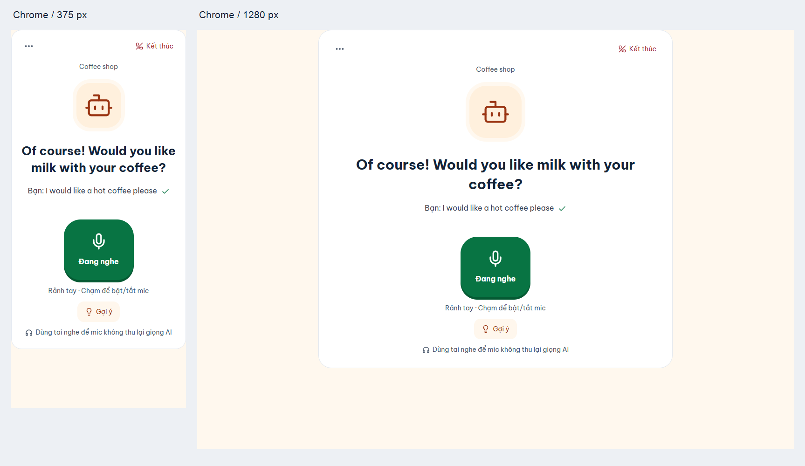

# Phòng gọi sau phản hồi Phase 1A — 13/11/2026

Đã hoàn thành bốn bước theo phạm vi đã sửa. Rảnh tay là mặc định. Không yêu cầu người dùng đo 20 lượt hoặc cung cấp ground truth.

## Giao diện và luồng gọi

- Một cột: avatar lớn, câu AI 26px ở 375px/30px ở desktop, dòng “Bạn:” 16px, một mic lớn với màu/nhãn rõ. Kết thúc nhỏ ở góc.
- Từ mục tiêu, đồng hồ, lượt và feedback chi tiết được bỏ khỏi màn chính. Nút Gợi ý mở bottom sheet với ba câu mẫu. Sau lượt chỉ hiện ✓ hoặc “Thử nói lại?”.
- Rảnh tay: đợi `speechSynthesis.speaking=false` **và** `pending=false` liên tục 400ms, rồi mở mic. Tự gửi sau 1200ms im lặng; cộng 800ms nếu dừng ở từ nối/mạo từ. Các ngưỡng im lặng nhận từ cấu hình BE.
- Im lặng 8s chỉ hiện lời nhắc, không gửi/không tự kết thúc. Không gửi interim, chuỗi rỗng hoặc nhiễu ngắn. Menu nhỏ có bấm để nói, bật/tắt mic và fallback nhập văn bản đã có.
- Sửa việc nối trùng final packet; prefix được giữ khi engine tự restart. Giữ khóa đồng bộ của reducer, session ID, submitted guard và effect TTS duy nhất.

## Hiểu ý và xác nhận

Mỗi lượt Gemini nhận tên kịch bản, mục tiêu từ description/system prompt, 8–12 từ tình huống lấy trực tiếp từ dữ liệu kịch bản, câu AI gần nhất đã lưu, ba cặp USER/AI gần nhất, raw transcript, alternatives và confidence. Không thêm một request tạo ngữ cảnh; không dùng các flashcard ngẫu nhiên làm ngữ cảnh.

- `intendedUtterance`: chỉ thay từ bị nghe nhầm theo ngữ cảnh, giữ lỗi ngữ pháp và cách diễn đạt gốc.
- `intentConfidence`: HIGH/MEDIUM/LOW, là mức chắc chắn về ý nghĩa, không phải điểm phát âm.
- LOW: BE giới hạn aiReply thành một câu xác nhận ngắn. Nếu câu trước đã là xác nhận, BE dùng câu tiếp tục kịch bản, không lặp vòng hỏi xác nhận.
- Hoàn toàn lạc đề/chữ rác: giữ raw, nói “Sorry, I didn't catch that” và diễn đạt lại câu hỏi đơn giản hơn. Việc nhận diện off-topic do Gemini thực hiện; vẫn có khả năng phân loại sai.
- Log DEBUG tự động `VOICE_STT` chứa raw/intendedUtterance/intentConfidence, JSON escape xuống dòng. Dev bật DEBUG cho VoiceAiService; INFO không ghi những trường này. Không có chỉ tiêu 20 lượt hoặc tỷ lệ sai nghĩa.
- Dòng “Bạn:” chỉ lấy intended từ BE sau phản hồi; lúc nghe/chờ dùng raw mờ. Không dùng raw giả làm intended khi BE không trả trường này.

API v1 giữ các trường legacy; chỉ bổ sung `alternativeDetails[{transcript,confidence}]` tùy chọn trong request và `intentConfidence` trong response. Câu AI trước lấy từ DB, không tin giá trị client để điều khiển guard xác nhận. Không thêm endpoint/bảng/migration.

## Tổng kết

Chi tiết chuyển về VoiceReportModal: câu AI hiểu, câu tự nhiên hơn, tối đa ba lỗi chính toàn phiên, và mẹo có nhãn **Mẹo** cùng giải thích chỉ dựa trên văn bản. Mẹo được giữ trong state phiên hiện tại; không thêm cột DB lưu mẹo. Các correction đã lưu tiếp tục lấy từ BE. Lượt degraded được ghi “Chưa có đánh giá”, không khẳng định câu đã đúng.

Chưa có thao tác lưu cụm từ vào flashcard trong voice flow hiện tại; để Phase 2. Không đổi công thức XP, streak hoặc điều chỉnh độ khó.

## Kiểm chứng

| Kiểm tra | Kết quả |
|---|---|
| `npx tsc --noEmit`, `npm run build`, typecheck bộ test | PASS |
| Backend `mvnw.cmd test` / tests trong package | 397 case: 366 đạt, 31 bỏ qua, 0 lỗi/thất bại |
| WAR | Đã package và restart; health HTTP 200 |
| Chrome dev, StrictMode bật | 12/12 đạt |
| Chrome production fixture | 12/12 đạt |
| 375px / 1280px | Không tràn ngang; nội dung chính ≥14px, câu AI ≥24px |
| Key Gemini trong log local mới | Không tìm thấy giá trị key hiện tại |

Các ca Chrome gồm nói đủ ý tự gửi đúng một lần; final lặp không nối trùng; im lặng 8s/interim/nhiễu không gửi hoặc kết thúc; từ nối được đợi thêm; pending TTS chặn mic; mic tắt không tự bật; engine restart giữ câu/alternatives; PTT gửi thủ công; bottom sheet; raw→intended; tổng kết tối đa ba lỗi; native TTS `speak()` đúng một lần. Trace một lần chạy dev ghi khoảng TTS end→mic start **468ms / 468ms** cho lời chào và câu đáp.

Đây là Chrome thật chạy fixture React thật, API/STT/TTS dùng adapter ở các ca luồng; có riêng ca gọi native Chrome speech synthesis. Không coi đó là phép thử mic vật lý hoặc chứng minh chất lượng phát âm.

### Smoke BE + Gemini thật, dữ liệu chữ tổng hợp

| Raw | Intended | Confidence | Hành vi | HTTP/latency |
|---|---|---|---|---|
| I would like horse coffee | I would like hot coffee | HIGH | Gọi đúng hot coffee, hỏi có thêm bánh không | 200 / 7852ms |
| I would like eyes latte | I would like iced latte | HIGH | Gọi đúng iced latte, tiếp tục quán cà phê | 200 / 7632ms |
| purple satellites blarg triangle | Giữ nguyên raw | LOW | Sorry, I didn't catch that. Would you like some food, like cake or a croissant? | 200 / 7708ms |

Cả ba non-degraded; có matching DEBUG records. Đây không phải audio thật, không phải phép đo độ chính xác STT. Các ca LOW liên tiếp được ép bằng mock Gemini trong `VoiceIntentFlowTest`, không giả kết quả live. Session smoke đã abandon thành công (response rỗng).

Không commit MP3, manifest, token hoặc log riêng tư. Giữ các thay đổi Phase 0 đang có ngoài commit này. Dừng chờ duyệt; chưa triển khai Phase 1B/audio hay Phase 2.
